# Harvest Moon: Magical Melody – recompilación para PC

<p align="center">
  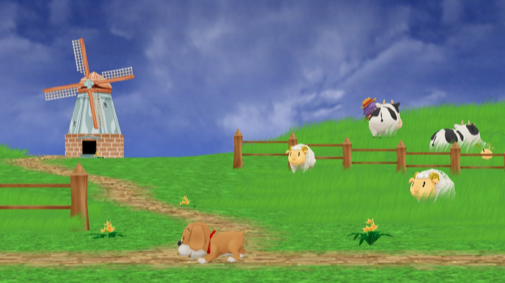
</p>

<p align="center"><a href="README.md">English</a> · <b>Español</b></p>

<p align="center"><a href="https://recomplauncher.com"><picture><source media="(prefers-color-scheme: dark)" srcset="https://recomplauncher.com/assets/press/launcher/badge-light.svg"></picture></a></p>

Una versión nativa de *Harvest Moon: Magical Melody* de GameCube para PC y
Android. El código del propio juego se traduce por adelantado a C++ y se
compila en un programa de Windows, Linux o Mac, o en una app de Android, que
corre en tu procesador, Intel, AMD o ARM, sin ningún emulador de por medio. Se
juega en pantalla ancha, a la resolución de tu pantalla y a 60 o 120 cuadros
por segundo, con un launcher, un menú de opciones dentro del juego, trucos y
mods, entre ellos uno con el que el juego sigue después de casarte con Jamie.
En el celular se juega con control o con botones táctiles.

El juego no viene incluido: necesitas tu propio disco. En la computadora, el
launcher arma el juego a partir de él la primera vez que juegas; en Android,
la app te pide el disco la primera vez que la abres.

> [!NOTE]
> **Versión 0.4.2.** El juego arranca, se juega, guarda y carga en Windows,
> Linux, Mac y Android, y ya se jugó en una laptop con Windows y un
> Snapdragon X. Todavía no se ha jugado de principio a fin, que es lo que
> significará la 1.0. Espera errores y guarda una copia de tus partidas.

- [Qué trae](#qué-trae)
- [Capturas](#capturas)
- [Cómo jugar](#cómo-jugar)
- [Cómo funciona](#cómo-funciona)
- [Lo que sigue](#lo-que-sigue)
- [Para desarrolladores](#para-desarrolladores)
- [Créditos](#créditos)
- [Licencia](#licencia)

## Qué trae

### El juego, nativo

- **Sin emulador.** Cada función del juego se traduce a C++ y corre como
  código nativo, en x64 o ARM64. Lo que hacía el hardware de la GameCube lo
  hace un runtime escrito para este juego (`runtime/`).
- **Gráficos** con [aurora](https://github.com/encounter/aurora), que dibuja
  los gráficos de la GameCube con WebGPU: Direct3D 12 en Windows, Vulkan en
  Linux y Android, y Metal en Mac.
- **Sonido** con el programa de sonido de la consola (el AX del DSP) reescrito
  en C++ a partir de la emulación de alto nivel de Dolphin, y tocado con SDL.
- **Controles**: los que SDL conoce (Xbox, PlayStation, Nintendo, adaptadores
  de GameCube), asignados solos; sin control, el teclado, y en Android los
  botones táctiles.
- **Partidas** en una memory card que es una carpeta de archivos `.gci`, como
  en Dolphin, así que puedes traer una partida.
- **Cargas** directo desde la imagen del disco, sin lector que esperar.

### Imagen, velocidad y sonido

| Opción | Qué hace |
|---|---|
| Resolución interna | Como la ventana, 480p, 720p, 1080p o 1440p. |
| Pantalla ancha | El 3D muestra más a los lados. Por ahora los menús y los textos se estiran. |
| Cuadros por segundo | 30, como el juego, o 60 y 120: el juego dibuja 30 y los demás se hacen entre ellos. |
| Idioma | Uno para el juego y el launcher: inglés, español, francés, alemán o italiano, los que trae el disco. El launcher y el menú F10 solo están en español e inglés. En el juego cambian los diálogos. Los menús y los nombres de los objetos siguen en inglés. |
| Turbo | No es una opción: mantén Tab en el juego (o TURBO en la pantalla táctil) y va al 300%. |
| Botones táctiles | Solo en Android: **Sin botones táctiles con control** los quita mientras haya un control conectado (vuelven si se desconecta), y **Sin botón TURBO táctil** quita solo TURBO. |
| Pantalla completa | También con Alt+Enter mientras juegas. |
| Contador de cuadros y volumen | Los cuadros por segundo sobre el juego, y el volumen de 0 a 100%. |

### El launcher

`HarvestMoonMM.exe` prepara el juego a partir de tu disco y lo arranca. Sus
cinco pestañas son **Juego** (preparar, jugar, cambiar el disco, elegir el
idioma, hacer la app de Android), **Opciones** (la tabla de arriba), **Mods**
(los de calidad de vida van al final, en su propia sección), **Trucos** y
**Controles** (muestra la asignación y qué es cada botón de tu control en el
de GameCube). Habla
español e inglés, y se usa con el mouse, el teclado o un control. Si algo
falla, dice por qué en palabras sencillas (otro juego, otra versión del juego,
una imagen que no pudo leer) y ofrece abrir el registro.

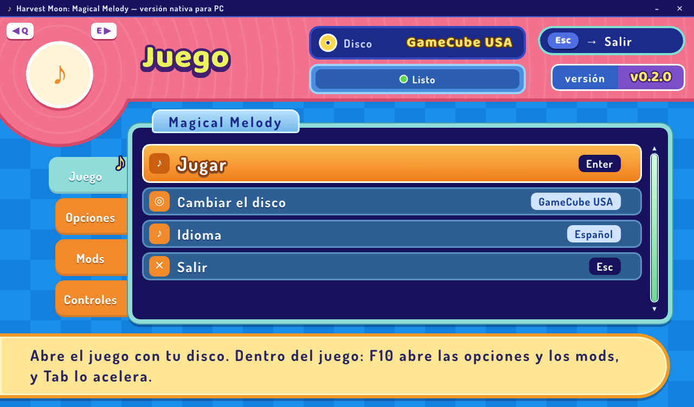

### Opciones dentro del juego

**F10**, el botón **Select** del control o, en Android, el botón de opciones
de arriba al centro abre las mismas opciones sin salir del juego, en una barra
sencilla arriba con menús desplegables: la resolución, Imagen (pantalla
completa, pantalla ancha, cuadros por segundo y el contador; en Android,
también las dos opciones de los botones táctiles), Ajustes del control,
Volumen, Idioma y Mods. Las opciones cambian al momento y se guardan para la
próxima vez. Los mods también se prenden o apagan ahí, con los de calidad de
vida aparte: los dos de la velocidad del personaje cambian al momento, y los
demás la próxima vez que se abre el juego (el menú dice cuál es cuál). Mientras
el menú está abierto, el juego no recibe el control.

### Mods

| Mod | Qué hace |
|---|---|
| **Casarse con Jamie** (0.8.0) | En el juego original, la boda con Jamie es el final. Con este mod, la boda se ve y el juego sigue: después de la ceremonia con la Diosa de la Cosecha sale una vez la escena de las notas musicales y apareces en tu casa, ya casado; a la mañana siguiente llega la nota musical de la boda. Desde entonces Jamie vive en la casa como tu pareja y habla como tu pareja, con frases nuevas en los cinco idiomas del disco, tiene cumpleaños (el 22 de invierno), y hay embarazo, parto y los días especiales del matrimonio, como con las demás parejas. Si te casas con Jamie, esa partida sigue usando el mod aunque lo desactives. |
| **Casarse con quien quieras** (0.2.1, experimental) | En el juego original el chico solo puede casarse con las diez chicas y la chica solo con los diez chicos. Con este mod puedes cortejar y casarte con cualquiera de los veinte, sea cual sea el personaje que elegiste: la pluma azul funciona con todos, las escenas de amor y la boda salen como con cualquier pareja, y en la boda llevas tu propio traje o vestido. Con una pareja del mismo sexo, las primeras palabras de tu pareja dicen «esposo» o «esposa» como debe ser, en los cinco idiomas, y en lugar del embarazo la Diosa de la Cosecha los llama a su estanque y les ofrece un bebé en adopción por su gran amor (si sigue de piedra, viene uno de sus duendes); le pones nombre y colocas su cuna en casa. Si te comprometes o te casas con alguien de tu mismo sexo, esa partida sigue usando el mod aunque lo desactives. |

#### Calidad de vida

Mods que no cambian la historia, solo hacen el día a día más cómodo. En el
launcher, en el menú F10 y en RecompLauncher salen en su propia sección, al
final.

| Mod | Qué hace |
|---|---|
| **Personaje más rápido** (0.1.0) | El personaje camina y corre más rápido, de 25% a 300% de la velocidad original (150% de entrada), solo mientras lo controlas tú. |
| **Sin frenos al cargar** (0.1.0) | En el juego original, con algo en las manos el personaje solo camina. Con este mod, con el stick a fondo avanza a la velocidad de correr. |
| **Cámara más lejos** (0.1.0) | En el juego, la cruceta arriba y abajo acerca y aleja la cámara. Con este mod, si sigues presionando abajo al llegar al tope del juego, se sigue alejando hasta que se ve mucho más de la granja; arriba la regresa. Solo al aire libre: los cuartos y las escenas conservan la cámara del juego. |
| **Días más largos** (0.1.0) | El reloj del juego avanza más despacio, para tener más tiempo cada día para cultivar, pescar y visitar: de 100% (el día del juego original) a 400% (un día cuatro veces más largo), 150% por omisión. Dormir, los eventos y el inicio del día no cambian. |
| **Estamina más amable** (0.1.0) | Todo lo que gasta estamina (las herramientas, la pesca, correr mucho) gasta solo una parte, de 10% a 100% (el juego original), 50% por omisión. Comer y dormir la devuelven como siempre, y el cansancio sigue haciendo que el trabajo cueste más. |
| **Herramientas que suben rápido** (0.1.0) | Cada uso de una herramienta cuenta más para que suba de nivel, de 100% (el juego original) a 400%, 200% por omisión. Por ahora no cambia una herramienta, la que el juego sube de otra manera. |

Todos vienen apagados, como el juego original; los enciendes en la pestaña
Mods, en el menú F10 o en la página del juego en RecompLauncher. Cómo hacer
uno: [mods/README.md](mods/README.md).

### Trucos

En la pestaña Trucos del launcher (y en RecompLauncher, en su propio grupo) hay cuatro
trucos, todos apagados hasta que los enciendes: **estamina infinita** (trabajar no gasta), **dinero
infinito** (se queda en 999,999 G), **detener el tiempo** (el reloj no avanza; dormir sigue pasando
al día siguiente) y **amistad al máximo** (con todos; no se puede deshacer en esa partida, y pueden
empezar escenas de amor y de rivales). Se guardan en `settings.json`, en `cheats`, y los hace el mod
`cheats` ([mods/cheats/mod.c](mods/cheats/mod.c)).

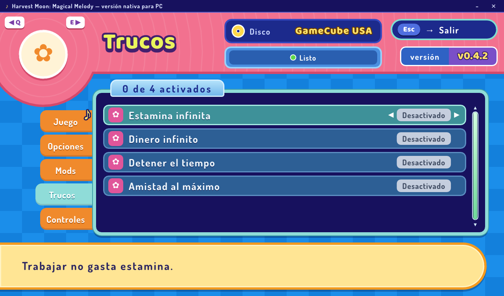

#### Casarse con Jamie, funcionando en el juego

<table>
  <tr>
    <td width="50%">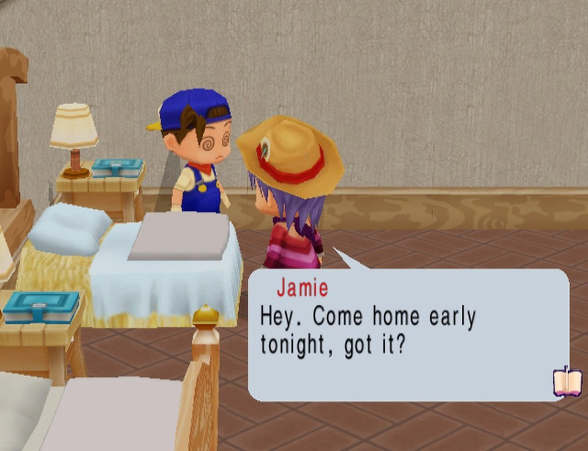</td>
    <td width="50%">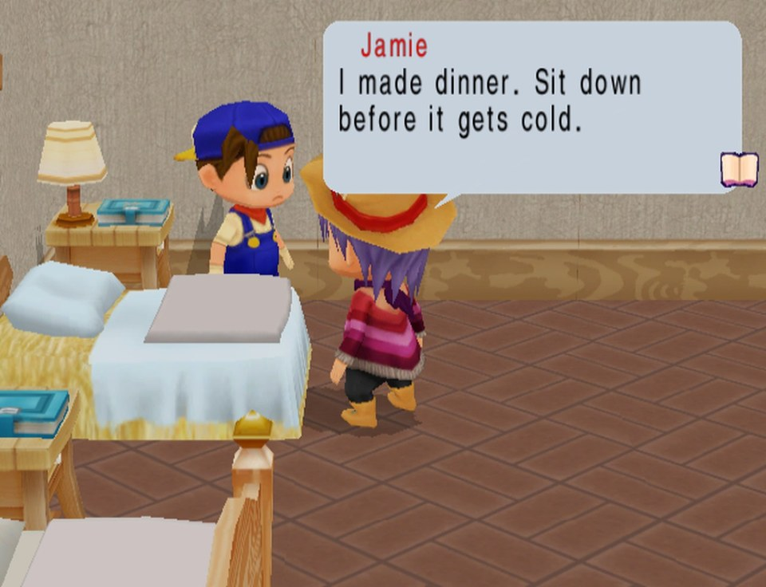</td>
  </tr>
  <tr>
    <td align="center">El aniversario de bodas, en la mañana…</td>
    <td align="center">…y la cena, cuando te acordaste</td>
  </tr>
  <tr>
    <td>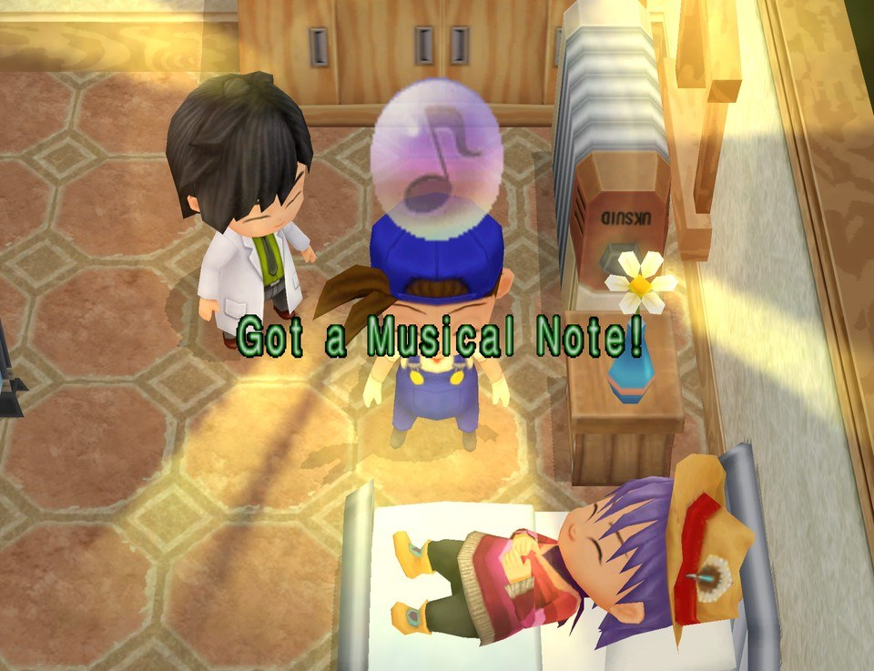</td>
    <td>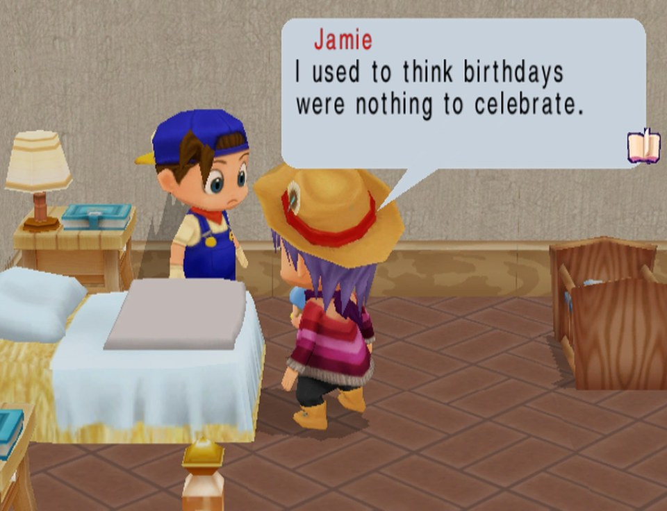</td>
  </tr>
  <tr>
    <td align="center">El embarazo, con su nota musical</td>
    <td align="center">El cumpleaños del hijo</td>
  </tr>
  <tr>
    <td colspan="2" align="center">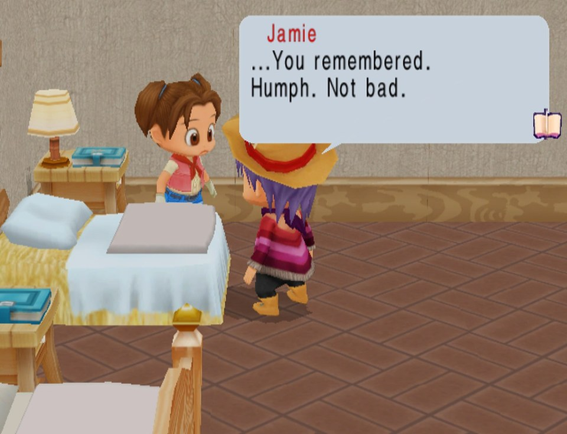</td>
  </tr>
  <tr>
    <td colspan="2" align="center">Jugando como la chica, en el aniversario</td>
  </tr>
</table>

## Capturas

<table>
  <tr>
    <td width="50%">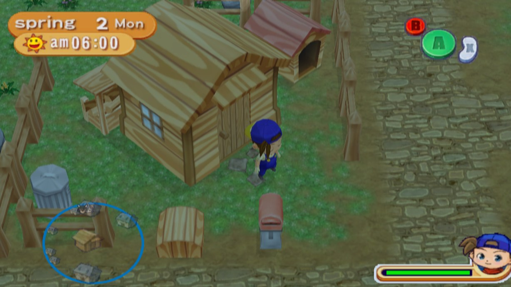</td>
    <td width="50%">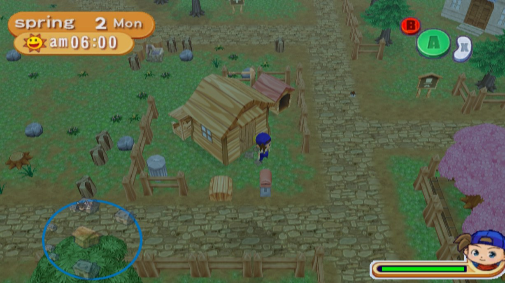</td>
  </tr>
  <tr>
    <td align="center">Pantalla ancha, con la cámara del juego</td>
    <td align="center">El mismo momento con el mod Cámara más lejos, alejada al máximo</td>
  </tr>
  <tr>
    <td>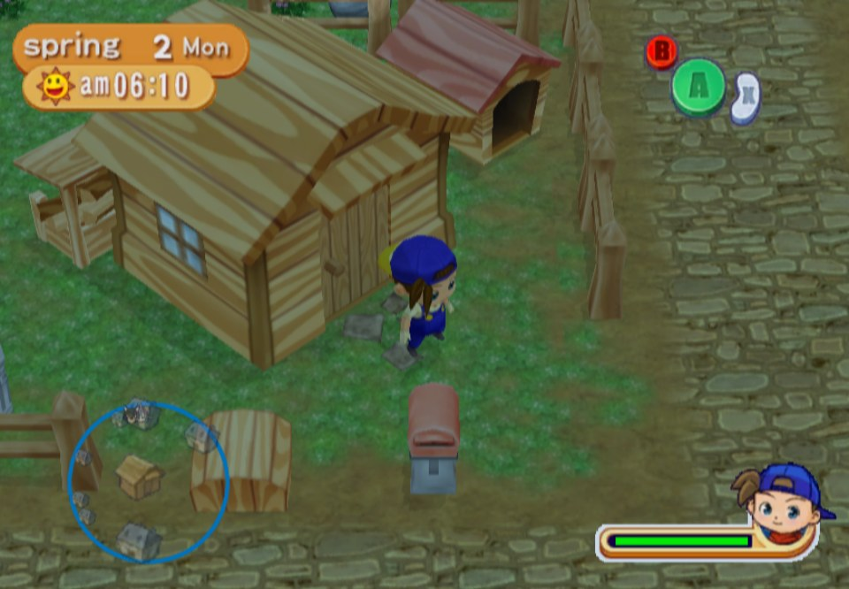</td>
    <td>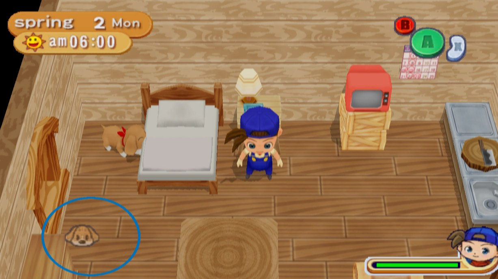</td>
  </tr>
  <tr>
    <td align="center">4:3, como en la GameCube</td>
    <td align="center">La casa en la mañana</td>
  </tr>
  <tr>
    <td>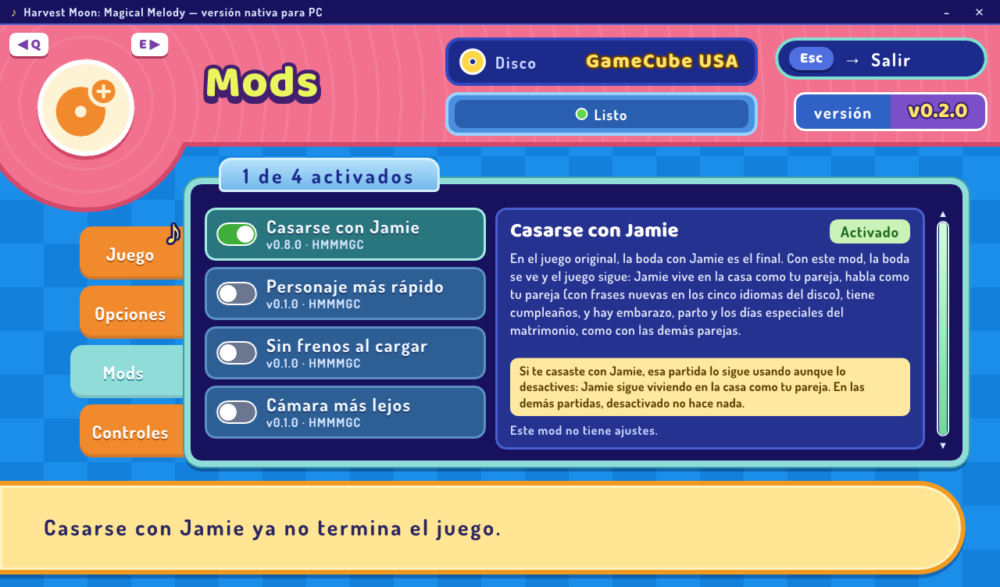</td>
    <td>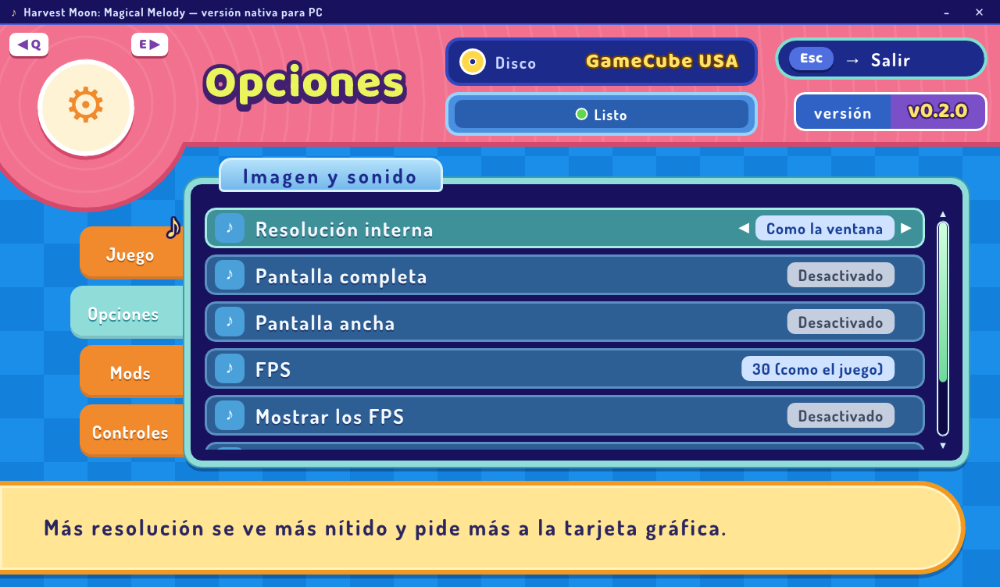</td>
  </tr>
  <tr>
    <td align="center">Los mods del launcher</td>
    <td align="center">Las opciones del launcher</td>
  </tr>
  <tr>
    <td>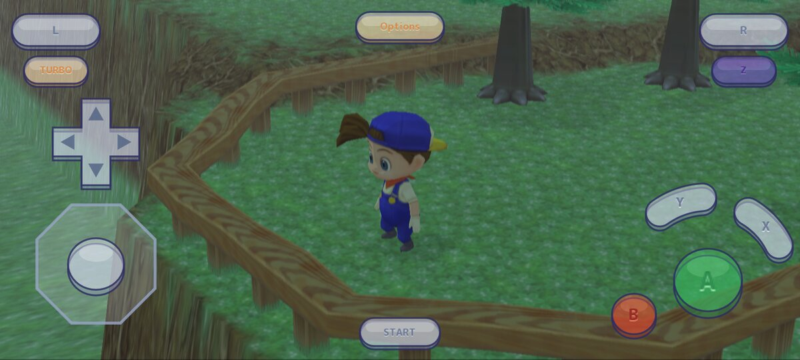</td>
    <td>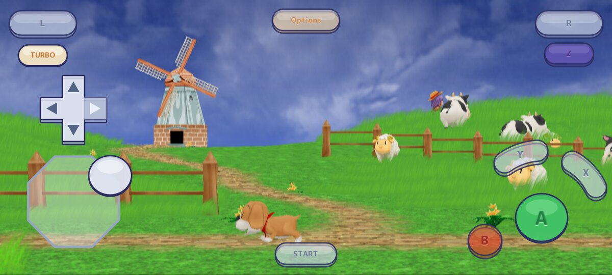</td>
  </tr>
  <tr>
    <td align="center">Al tamaño de un celular (20:9), con los botones táctiles</td>
    <td align="center">A, el stick, la flecha derecha y TURBO apretados</td>
  </tr>
</table>

## Cómo jugar

### Qué necesitas

| | Requisitos mínimos |
|---|---|
| Sistema | Windows 10 (versión 1903 o más nueva) o Windows 11, de 64 bits. O un Linux de 64 bits con glibc 2.38 o más nueva: Ubuntu 24.04 o más nuevo, Debian 13, Fedora 39 o más nuevo, Arch, SteamOS 3.6 o más nuevo (Steam Deck). O macOS 12 o más nuevo, con Apple Silicon o Intel. O Android 8 o más nuevo, en un celular o tableta ARM64 con Vulkan. |
| Procesador | Intel o AMD con SSE4.2 (Intel desde 2008, AMD desde 2011): el paquete **x64**. Uno ARM como el Snapdragon: el paquete **arm64**. |
| Memoria | 4 GB de RAM; mejor 8 GB. La primera vez, el juego se compila en tu computadora, con un compilador por cada núcleo del procesador, de hasta unos 250 MB cada uno. |
| Gráficos | Una tarjeta gráfica, o los gráficos del procesador, con Direct3D 12 (Windows), Vulkan (Linux y Android) o Metal (Mac). |
| Disco | Unos 3 GB libres: el paquete descomprimido (unos 550 MB), el `.iso` al que se convierte una imagen `.rvz` y el juego preparado (unos 100 MB). En Android, unos 1.5 GB: la app y la copia del disco (1.4 GB). |
| Juego | Tu disco de *Harvest Moon: Magical Melody* de Estados Unidos (`G4AEE9`), como imagen: `.iso`, `.gcm` o `.rvz` (el formato comprimido de Dolphin). El launcher revisa que sea ese juego y esa versión. |

Probado en una laptop con Snapdragon X (gráficos Adreno X1-45), que mantiene
60 fps en pantalla ancha. No se ha probado en computadoras más débiles; en una
cerca del mínimo, lo más seguro es jugar a 30 fps.

### Pasos

1. Descarga el zip de tu procesador en
   [Releases](https://github.com/RodoLy/HMMMGC/releases).
2. Antes de descomprimirlo, clic derecho → *Propiedades* → marca
   *Desbloquear* → *Aceptar*. Si no, Windows puede detener las herramientas que
   preparan el juego.
3. Descomprime todo en una carpeta y abre `HarvestMoonMM.exe`. El programa no
   está firmado, así que Windows puede decir que no conoce al editor:
   *Más información* → *Ejecutar de todas formas*.
4. Elige **Preparar el juego** y escoge la imagen de tu disco (o suéltala en
   la ventana). La primera vez, el juego se arma para tu computadora: tarda
   unos minutos, y ya no vuelve a hacerlo hasta la siguiente actualización.
5. Presiona **Jugar**.

El launcher también se maneja con control: la cruceta o el stick izquierdo
mueven, A elige, LB y RB cambian de pestaña y B regresa (en la pestaña del
juego, sale o detiene la preparación). Si la imagen de tu disco está en
Descargas, Documentos, el Escritorio, una carpeta `Games`, junto a
`HarvestMoonMM.exe` o en una carpeta de la lista de juegos de Dolphin, el
launcher la encuentra solo y **Preparar el juego** la usa, así que no
necesitas el mouse para elegirla.

**En Linux.** Descarga el `.tar.gz` de tu procesador, descomprímelo y abre
`HarvestMoonMM`; de ahí en adelante es igual que en Windows. Trae su propio
compilador, así que no hay nada que instalar, tampoco en la Steam Deck (en el
modo escritorio; después agrega `HarvestMoonMM` a Steam como juego que no es
de Steam para jugarlo desde el modo juego). Todo lo tuyo queda en
`~/.local/share/HarvestMoonMM`.

**En Mac.** Descarga el zip de tu Mac (`arm64` para Apple Silicon, `x64` para
Intel), descomprímelo y mueve `HarvestMoonMM.app` a Aplicaciones. No está
firmado por Apple, así que ábrelo la primera vez con clic derecho → *Abrir* (en
macOS 15, si no aparece: intenta abrirlo, luego *Configuración del Sistema* →
*Privacidad y seguridad* → *Abrir de todas formas*). El juego se compila con
las Command Line Tools de Apple; si tu Mac no las tiene, el launcher abre su
instalador. Todo lo tuyo queda en `~/Library/Application Support/HarvestMoonMM`.

**En Android.** Descarga `HarvestMoonMM-<versión>.apk` del release e instálala
en el celular (Android 8 o más nuevo, ARM64, con Vulkan). Pon también en el
celular la imagen de tu disco, en `.iso` o `.gcm` (una `.rvz` se convierte a
`.iso` con Dolphin: clic derecho en el juego → *Convertir archivo*). La primera
vez que abres la app te pide el disco, lo revisa y lo copia a la app (1.4 GB;
después puedes borrar tu copia). El APK trae el código del juego traducido a
ARM64, pero nada de sus gráficos, música ni textos: eso siempre sale de tu
disco. Se juega con control o con botones táctiles dibujados sobre el juego
(ve [Controles](#controles)). Para actualizar, instala el APK nuevo encima del anterior: tus partidas se
quedan.

Si prefieres hacer el APK tú mismo con tu disco: descarga también el zip de
Android, descomprímelo dentro de la carpeta del paquete de Windows o de Linux y
usa **Hacer la app de Android** en la pestaña Juego del launcher.

**Con [RecompLauncher](https://recomplauncher.com).** El paquete trae un
`recomplauncher.json`, así que RecompLauncher puede instalarlo, revisar la
imagen de tu disco, preparar el juego sin abrir la ventana del launcher,
mostrar las opciones y los mods en la página del juego y arrancarlo. Usa el
mismo launcher (`HarvestMoonMM.exe --prepare <imagen>` y `--play`), así que el
juego, las opciones y las partidas son los mismos de las dos formas.

### Controles

El primer control que conectes juega, asignado solo. Sin control, juega el
teclado, con las mismas teclas que Dolphin trae de entrada. Se pueden cambiar
en el launcher, en la pestaña **Controles** (elige el dispositivo con ◀ ▶), o
en el juego: **F10** y luego **Ajustes del control**. Los dos guardan en el mismo
archivo, `controls.json`, junto a `settings.json`. Elige una parte del control de
GameCube y presiona la tecla (o un botón del ratón) o, en un control, el botón
que debe jugarla; los cambios se guardan solos, cada control tiene los suyos y
**Restablecer** vuelve a la asignación automática. (Las palancas de un control
siempre siguen a las del control.) Ahí mismo está **Turbo (acelerar)**: Tab
de entrada, y se le puede dar otra tecla o un botón del control.

| GameCube | Teclado |
|---|---|
| Stick de control | Flechas |
| Stick C | I, J, K, L |
| Cruceta | T, F, G, H |
| A, B, X, Y | X, Z, C, S |
| Z | D |
| L, R | Q, W |
| START | Enter |

Además: **F10** abre las opciones, mantener **Tab** acelera el juego y
**Alt+Enter** cambia a pantalla completa.

**Botones táctiles.** En Android, sobre el juego hay un control de GameCube
dibujado como los botones del propio juego y con sus colores (A verde, B roja,
Z morada), semitransparente para que el juego se vea debajo: el stick y la
cruceta a la izquierda; A, B, X y Y a la derecha; L, R y Z arriba; START abajo;
arriba al centro, el botón de opciones (como F10), y bajo L, **TURBO**, que
acelera el juego mientras lo mantienes. Se pueden apretar varios a la vez.
Desaparecen cuando usas un control o el teclado, y vuelven al tocar la
pantalla o al desconectar el control. Con las opciones de la tabla de arriba
se quitan mientras haya un control, o se quita solo TURBO.

### Tus partidas

Todo lo tuyo está en la carpeta `HarvestMoonMM`:

| Sistema | Carpeta |
|---|---|
| Windows | `%LOCALAPPDATA%\HarvestMoonMM` |
| Linux | `~/.local/share/HarvestMoonMM` |
| Mac | `~/Library/Application Support/HarvestMoonMM` |
| Android | Dentro de la app (se queda al actualizar; se borra si la desinstalas) |

Las partidas están en `Native/USA/Card A`, un archivo `.gci` por cada archivo
de la memory card. Para traer una partida de Dolphin, cuando guarda la memory
card como carpeta GCI, o de la versión anterior con ModernGekko, copia ahí su
`E9-G4AE-HARVESTMOON.gci`. Tus elecciones están en `settings.json` y tus
controles en `controls.json`, y los registros, `prepare.log` y `native.log`, en
la carpeta `Native`.

Si algo falla, abre un [issue](https://github.com/RodoLy/HMMMGC/issues) con
el registro.

## Cómo funciona

```
la imagen de tu disco (.iso, .gcm o .rvz)
   │  nodtool convierte un .rvz en .iso; el launcher revisa el juego y su versión
   ▼
main.dol: el código del juego, para el procesador PowerPC de la GameCube
   │  el traductor de WiiCompiled
   ▼
C++: cada función del juego, como una función de C++
   │  clang, con el kit del runtime, en tu computadora
   ▼
hmmm-native: el juego, como un programa para tu sistema
```

El procesador de la GameCube es un PowerPC, así que su código no puede correr
tal cual en una PC. El traductor de
[WiiCompiled](https://github.com/patchzyy/wiicompiled), la recompilación de
Mario Kart Wii, convierte cada función del juego en C++, y ese C++ se compila
junto con un runtime que le da lo que espera de la consola: la memoria, los
registros especiales del procesador, los hilos, alarmas e interrupciones del
sistema operativo, el disco, la memory card, los controles, los gráficos y el
sonido.

Los paquetes de computadora no traen el código traducido: traen todo lo
demás, el runtime ya compilado (el *kit del runtime*), el traductor, un
compilador de C++ (llvm-mingw en Windows, su clang en Linux; en Mac, el clang
de Apple) y Python. El launcher arma el programa en tu computadora a partir de
tu disco, y nada del paquete sale del disco. Los mods se compilan dentro del
programa, y los lugares donde actúan se marcan en el código traducido.

Un celular no puede compilar el juego, así que el APK de Android ya trae el
código traducido y compilado para ARM64, como las versiones de Android de
otras recompilaciones. Los gráficos, la música y los textos no vienen en él:
la app los lee siempre de tu disco.

Más: [docs/NATIVE_PACKAGE.md](docs/NATIVE_PACKAGE.md) (el paquete y la
preparación), [runtime/README.md](runtime/README.md) y
[docs/NATIVE_RUNTIME.md](docs/NATIVE_RUNTIME.md) (el runtime),
[docs/PLAN.md](docs/PLAN.md) (el plan completo).

Antes de la versión nativa, el juego recompilado corría con
[DolRecomp](https://github.com/ExpansionPak/DolRecomp) sobre
[ModernGekko](https://github.com/ExpansionPak/ModernGekko), que conserva el
núcleo de Dolphin para el hardware. Ese paquete sigue en el repositorio
([packaging/windows/README.md](packaging/windows/README.md)), y fue el banco
de pruebas del mod de Jamie.

## Lo que sigue

- **1.0**: el juego jugado de principio a fin.
- Los menús y los textos en 4:3 en pantalla ancha, en vez de estirados.
- El juego en español, francés, alemán o italiano: el disco americano trae
  las traducciones de un lanzamiento europeo que nunca salió.
- Más mods: adelantar las escenas.
- Actualizar desde el launcher.
- Después, las dos versiones de Wii del juego sobre el mismo runtime.

## Para desarrolladores

- El runtime nativo en Linux: `scripts/build_native_runtime.sh`
  ([runtime/README.md](runtime/README.md)). Necesita tu disco extraído en
  `orig/G4AEE9`.
- El launcher y los paquetes de Windows, Linux, macOS y Android, que GitHub
  Actions arma cuando se publica una versión, y el APK listo de cada versión:
  [docs/NATIVE_PACKAGE.md](docs/NATIVE_PACKAGE.md).
- La app de Android: [android/](android/).
- Cómo se analizó el juego: [docs/DISC_ANALYSIS.md](docs/DISC_ANALYSIS.md),
  [docs/FUNCTION_MAP.md](docs/FUNCTION_MAP.md) (4 486 funciones, validadas
  contra el índice de excepciones de CodeWarrior) y
  [docs/VALIDATION.md](docs/VALIDATION.md) (el código recompilado comparado
  con el intérprete de Dolphin, jugando e instrucción por instrucción).

**Binario objetivo:** `Harvest Moon: Magical Melody (USA)`, ID `G4AEE9`,
revisión 0. `sys/main.dol` SHA-1 `5977972cd798d60ecfcf5c1f26a86dcecc36446f`.

Las herramientas de análisis necesitan Python 3.11 o más nuevo, y Rust para
instalar `nodtool`:

```sh
# 1. Herramientas
cargo install nodtool                    # lee ISO/GCM/RVZ
python3 -m pip install -r requirements-dev.txt   # capstone, pytest, ruff

# 2. Extrae tu disco a orig/G4AEE9 y verifica que sea el binario correcto
python3 tools/extract_disc.py ruta/a/tu/disco.rvz
python3 tools/check_disc.py

# 3. Regenera y comprueba el mapa de funciones
python3 tools/analyze.py
HM_MM_DOL=orig/G4AEE9/sys/main.dol python3 -m pytest

# 4. Lee cualquier función
python3 tools/disasm.py main
```

En Windows:

- Instala el Python **x64** de [python.org](https://www.python.org/downloads/windows/),
  también si tu PC tiene procesador ARM: `capstone` no publica paquete
  precompilado (wheel) para Windows ARM64, y Python x64 corre ahí gracias a la
  emulación de Windows 11. (Con Visual Studio y sus herramientas de C++ para
  ARM64 también sirve el Python ARM64: `pip` compila `capstone` desde el código
  fuente; así lo hace el workflow de GitHub.)
- Usa `py` en lugar de `python3`. En PowerShell, la variable de los tests se
  define así:

  ```powershell
  $env:HM_MM_DOL = "orig/G4AEE9/sys/main.dol"
  py -m pytest
  ```

- Si ya usas Dolphin no necesitas Rust ni `nodtool`: clic derecho en el juego →
  *Properties* → pestaña *Filesystem* → clic derecho en el disco →
  *Extract Entire Disc...*, y elige la carpeta `orig\G4AEE9`. Después
  `py tools/check_disc.py` confirma que quedó bien.

Antes de contribuir lee [CONTRIBUTING.md](CONTRIBUTING.md).

## Créditos

- [WiiCompiled](https://github.com/patchzyy/wiicompiled): el traductor, y el
  ejemplo de una recompilación que corre sin emulador.
- [aurora](https://github.com/encounter/aurora): los gráficos, los controles
  y la memory card de la GameCube, sobre
  [Dawn](https://dawn.googlesource.com/dawn) (WebGPU).
- [Dolphin](https://dolphin-emu.org/): la referencia del hardware; el
  programa de sonido está portado de su emulación de alto nivel.
- [DolRecomp](https://github.com/ExpansionPak/DolRecomp) y
  [ModernGekko](https://github.com/ExpansionPak/ModernGekko): la primera
  recompilación jugable del juego.
- [SDL](https://www.libsdl.org/), [Dear ImGui](https://github.com/ocornut/imgui),
  [nod](https://github.com/encounter/nod),
  [llvm-mingw](https://github.com/mstorsjo/llvm-mingw) y las fuentes Baloo 2,
  Dosis, M PLUS Rounded 1c y DejaVu Sans. La lista completa, con las
  licencias, está en
  [packaging/native/THIRD_PARTY_NOTICES.txt](packaging/native/THIRD_PARTY_NOTICES.txt).

## Licencia

GNU General Public License, versión 3 o posterior (GPL-3.0-or-later); el
texto está en [LICENSE](LICENSE). Es la licencia de WiiCompiled y de
ModernGekko, y es compatible con las de DolRecomp y Dolphin. Los parches de
`patches/` modifican archivos derivados de Dolphin que son GPL-2.0-or-later y
se ofrecen con esos mismos términos.

Este es un proyecto de fans, sin relación con Natsume, Marvelous ni Nintendo.
*Harvest Moon: Magical Melody* lo desarrolló Marvelous Interactive y lo
publicó Natsume. Ninguna parte del juego está en este repositorio ni en los
paquetes de computadora. El APK de Android listo de cada release trae el
código del juego traducido a ARM64, como las versiones de Android de otras
recompilaciones, pero nada de los archivos del disco (gráficos, música,
textos), que siempre salen del disco del propio jugador.
