# Harvest Moon: Magical Melody – recompilación para PC

<p align="center">
  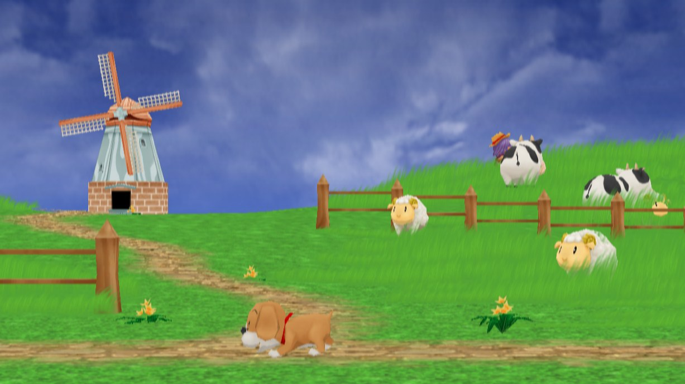
</p>

<p align="center"><a href="README.md">English</a> · <b>Español</b></p>

Una versión nativa para PC de *Harvest Moon: Magical Melody* de GameCube. El
código del propio juego se traduce por adelantado a C++ y se compila en un
programa de Windows que corre en tu procesador, Intel, AMD o ARM, sin ningún
emulador de por medio. Se juega en pantalla ancha, a la resolución de tu
pantalla y a 60 o 120 cuadros por segundo, con un launcher, un menú de
opciones dentro del juego y mods, entre ellos uno con el que el juego sigue
después de casarte con Jamie.

El juego no viene incluido: necesitas tu propio disco. El launcher arma el
juego a partir de él, en tu computadora, la primera vez que juegas.

> [!NOTE]
> **Versión 0.1.0, la primera versión jugable.** El juego arranca, se juega,
> guarda y carga, y ya se jugó en una laptop con Windows y un Snapdragon X.
> Todavía no se ha jugado de principio a fin, que es lo que significará la
> 1.0. Espera errores y guarda una copia de tus partidas.

- [Qué trae](#qué-trae)
- [Capturas](#capturas)
- [Cómo jugar](#cómo-jugar)
- [Cómo funciona](#cómo-funciona)
- [Lo que sigue](#lo-que-sigue)
- [Para desarrolladores](#para-desarrolladores)
- [Créditos](#créditos)
- [Licencia](#licencia)

## Qué trae

### El juego, nativo

- **Sin emulador.** Cada función del juego se traduce a C++ y corre como
  código nativo, en x64 o ARM64. Lo que hacía el hardware de la GameCube lo
  hace un runtime escrito para este juego (`runtime/`).
- **Gráficos** con [aurora](https://github.com/encounter/aurora), que dibuja
  los gráficos de la GameCube con WebGPU: Direct3D 12 en Windows y Vulkan en
  Linux.
- **Sonido** con el programa de sonido de la consola (el AX del DSP) reescrito
  en C++ a partir de la emulación de alto nivel de Dolphin, y tocado con SDL.
- **Controles**: los que SDL conoce (Xbox, PlayStation, Nintendo, adaptadores
  de GameCube), asignados solos; sin control, el teclado.
- **Partidas** en una memory card que es una carpeta de archivos `.gci`, como
  en Dolphin, así que puedes traer una partida.
- **Cargas** directo desde la imagen del disco, sin lector que esperar.

### Imagen, velocidad y sonido

| Opción | Qué hace |
|---|---|
| Resolución interna | Como la ventana, 480p, 720p, 1080p o 1440p. |
| Pantalla ancha | El 3D muestra más a los lados. Por ahora los menús y los textos se estiran. |
| Cuadros por segundo | 30, como el juego, o 60 y 120: el juego dibuja 30 y los demás se hacen entre ellos. |
| Zoom de la cámara | Al aire libre, de 50% (se ve mucho más de la granja) a 200%. Los cuartos y las escenas conservan la cámara del juego. |
| Velocidad de todo el juego | De 100% a 400%, y un turbo: mantener Tab va al menos a 300%. |
| Pantalla completa | También con Alt+Enter mientras juegas. |
| Contador de cuadros y volumen | Los cuadros por segundo sobre el juego, y el volumen de 0 a 100%. |

### El launcher

`HarvestMoonMM.exe` prepara el juego a partir de tu disco y lo arranca. Sus
cuatro pestañas son **Juego** (preparar, jugar, cambiar el disco, abrir el
registro), **Opciones** (la tabla de arriba), **Mods** y **Controles** (muestra
la asignación y qué es cada botón de tu control en el de GameCube). Habla
español e inglés, y se usa con el mouse, el teclado o un control. Si algo
falla, dice por qué en palabras sencillas (otro juego, otra versión del juego,
una imagen que no pudo leer) y ofrece abrir el registro.

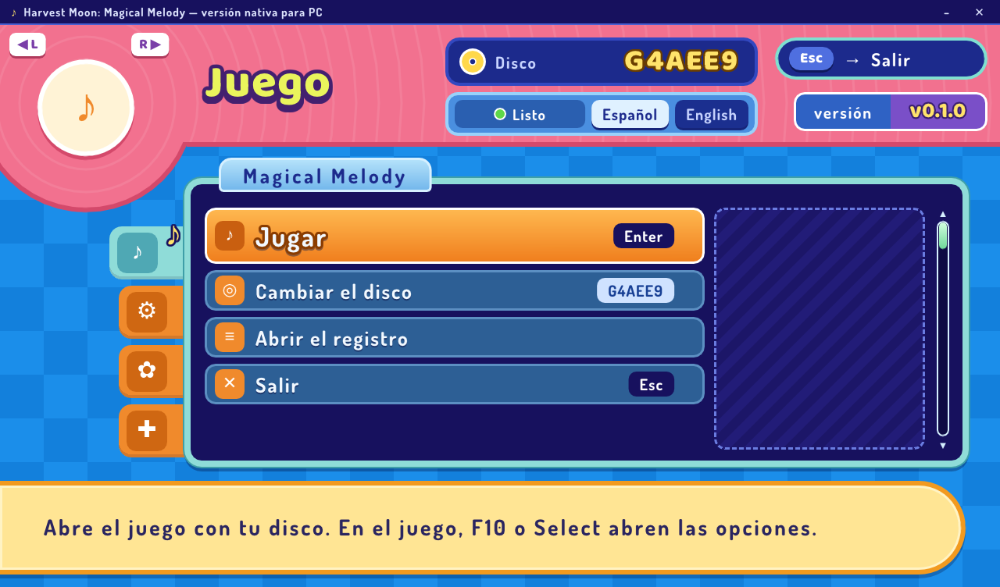

### Opciones dentro del juego

**F10**, o el botón **Select** del control, abre las mismas opciones sin salir
del juego. Cambian al momento y se guardan para la próxima vez; ahí también
está la pantalla de controles. Mientras el menú está abierto, el juego no
recibe el control.

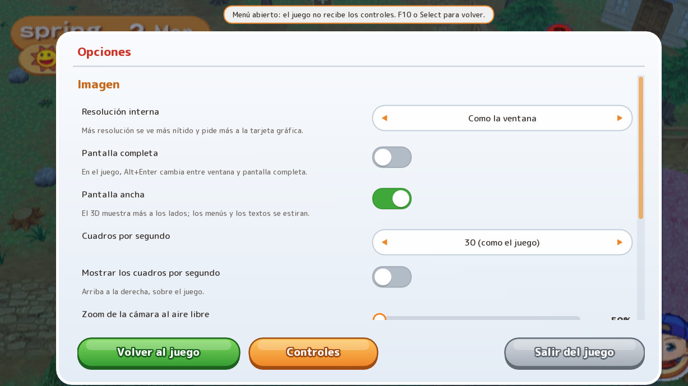

### Mods

| Mod | Qué hace |
|---|---|
| **Casarse con Jamie** (0.8.0) | En el juego original, la boda con Jamie es el final. Con este mod, la boda se ve y el juego sigue: Jamie vive en la casa como tu pareja y habla como tu pareja, con frases nuevas en los cinco idiomas del disco, tiene cumpleaños (el 22 de invierno), y hay embarazo, parto y los días especiales del matrimonio, como con las demás parejas. |
| **Personaje más rápido** (0.1.0) | El personaje camina y corre más rápido, de 25% a 300% de la velocidad original (150% de entrada), solo mientras lo controlas tú. |

Los dos están activados mientras la pestaña Mods no los apague. Cómo hacer
uno: [mods/README.md](mods/README.md).

#### Casarse con Jamie, funcionando en el juego

<table>
  <tr>
    <td width="50%">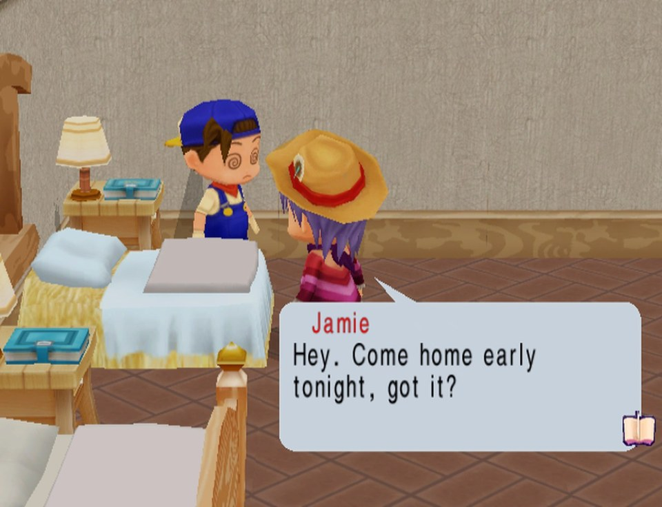</td>
    <td width="50%">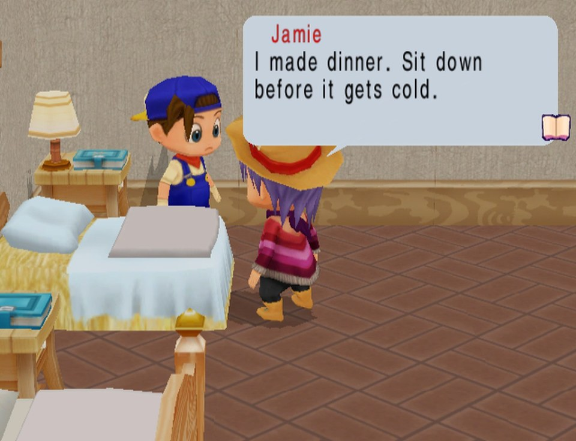</td>
  </tr>
  <tr>
    <td align="center">El aniversario de bodas, en la mañana…</td>
    <td align="center">…y la cena, cuando te acordaste</td>
  </tr>
  <tr>
    <td>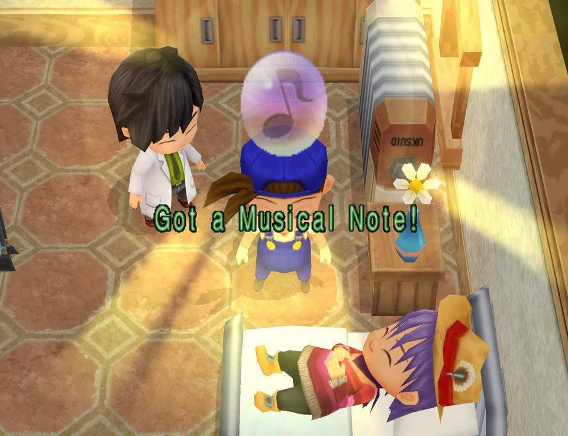</td>
    <td>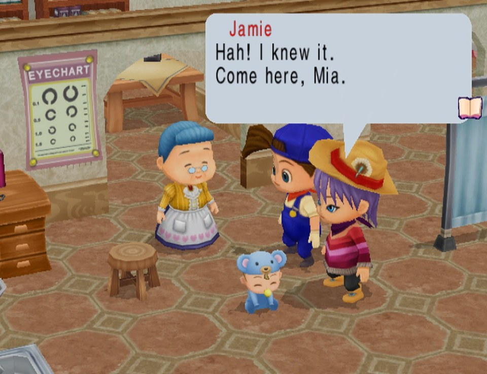</td>
  </tr>
  <tr>
    <td align="center">El embarazo, con su nota musical</td>
    <td align="center">La revisión de Mia en la clínica</td>
  </tr>
  <tr>
    <td>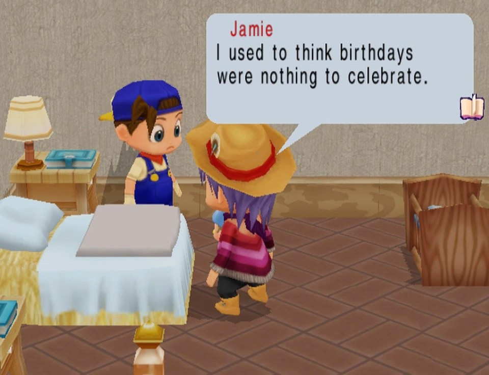</td>
    <td>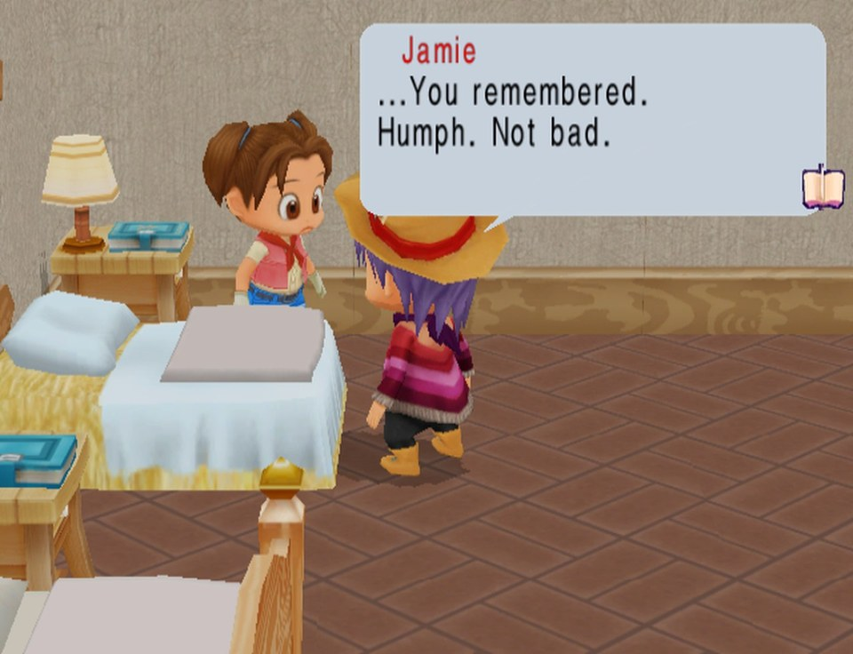</td>
  </tr>
  <tr>
    <td align="center">El cumpleaños de Mia</td>
    <td align="center">Jugando como la chica, en el aniversario</td>
  </tr>
</table>

## Capturas

<table>
  <tr>
    <td width="50%">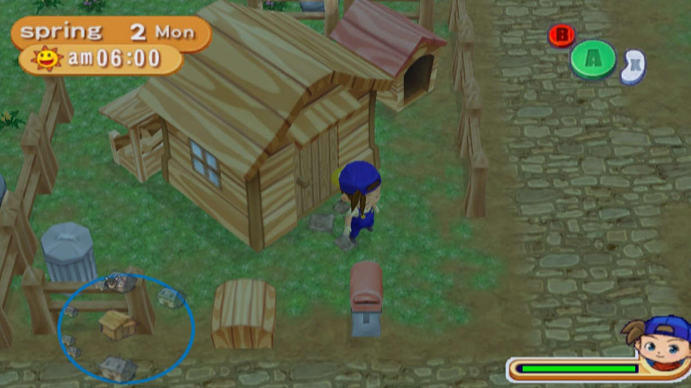</td>
    <td width="50%">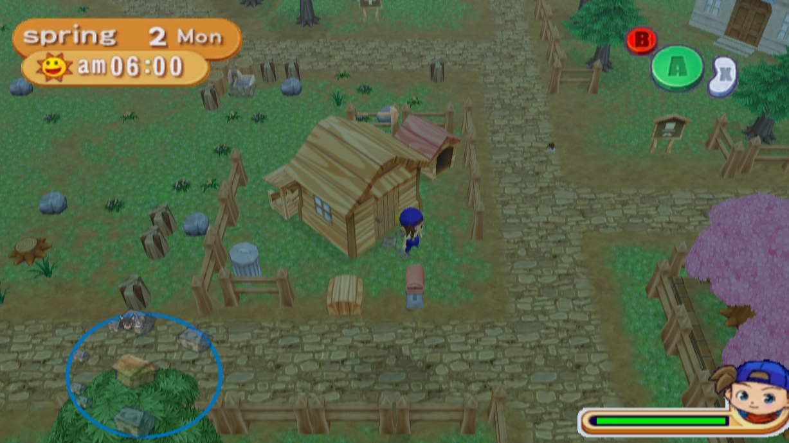</td>
  </tr>
  <tr>
    <td align="center">Pantalla ancha, con la cámara del juego</td>
    <td align="center">El mismo momento, con la cámara a 50%</td>
  </tr>
  <tr>
    <td>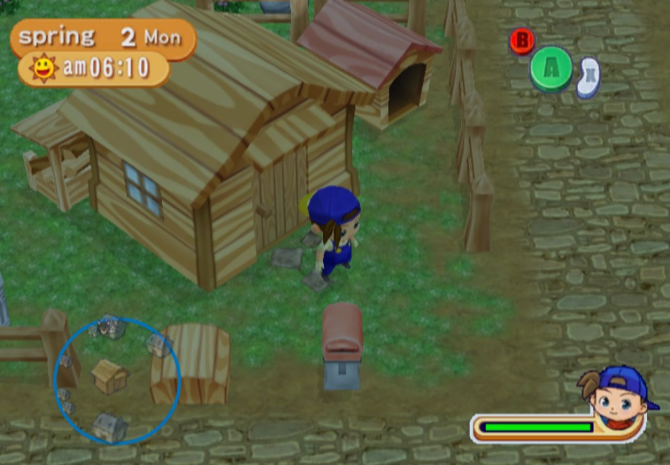</td>
    <td>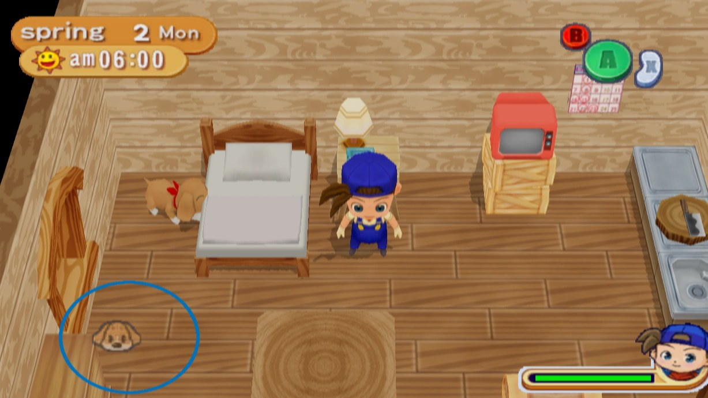</td>
  </tr>
  <tr>
    <td align="center">4:3, como en la GameCube</td>
    <td align="center">La casa en la mañana</td>
  </tr>
  <tr>
    <td>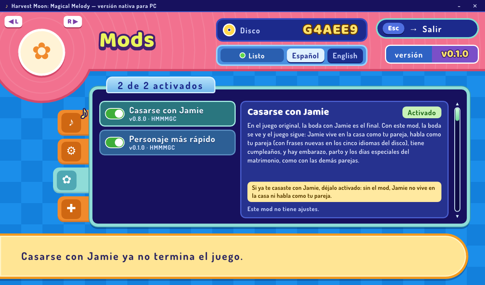</td>
    <td>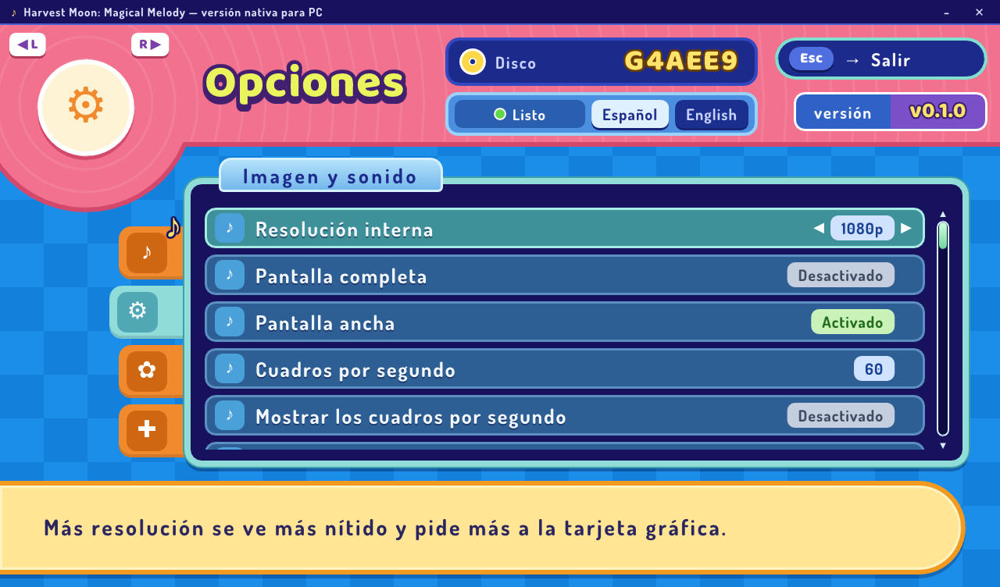</td>
  </tr>
  <tr>
    <td align="center">Los mods del launcher</td>
    <td align="center">Las opciones del launcher</td>
  </tr>
</table>

## Cómo jugar

### Qué necesitas

- Windows 10 (versión 1903 o más nueva) o Windows 11, con un procesador Intel
  o AMD (el paquete **x64**) o uno ARM como el Snapdragon (el paquete
  **arm64**).
- Una tarjeta gráfica con Direct3D 12.
- Tu disco de *Harvest Moon: Magical Melody* de Estados Unidos (`G4AEE9`),
  como imagen: `.iso`, `.gcm` o `.rvz` (el formato comprimido de Dolphin). El
  launcher revisa que sea ese juego y esa versión.
- Unos 2 GB libres: una imagen `.rvz` se convierte a `.iso`, y el juego
  preparado ocupa unos 100 MB.

### Pasos

1. Descarga el zip de tu procesador en
   [Releases](https://github.com/RodoLy/HMMMGC/releases).
2. Antes de descomprimirlo, clic derecho → *Propiedades* → marca
   *Desbloquear* → *Aceptar*. Si no, Windows puede detener las herramientas que
   preparan el juego.
3. Descomprime todo en una carpeta y abre `HarvestMoonMM.exe`. El programa no
   está firmado, así que Windows puede decir que no conoce al editor:
   *Más información* → *Ejecutar de todas formas*.
4. Elige **Preparar el juego** y escoge la imagen de tu disco (o suéltala en
   la ventana). La primera vez, el juego se arma para tu computadora: tarda
   unos minutos, y ya no vuelve a hacerlo hasta la siguiente actualización.
5. Presiona **Jugar**.

### Controles

El primer control que conectes juega, asignado solo. Sin control, juega el
teclado, con las mismas teclas que Dolphin trae de entrada:

| GameCube | Teclado |
|---|---|
| Stick de control | Flechas |
| Stick C | I, J, K, L |
| Cruceta | T, F, G, H |
| A, B, X, Y | X, Z, C, S |
| Z | D |
| L, R | Q, W |
| START | Enter |

Además: **F10** abre las opciones, mantener **Tab** acelera el juego y
**Alt+Enter** cambia a pantalla completa.

### Tus partidas

Están en `%LOCALAPPDATA%\HarvestMoonMM\Native\USA\Card A`, un archivo `.gci`
por cada archivo de la memory card. Para traer una partida de Dolphin, cuando
guarda la memory card como carpeta GCI, o de la versión anterior con
ModernGekko, copia ahí su `E9-G4AE-HARVESTMOON.gci`. Tus elecciones están en
`%LOCALAPPDATA%\HarvestMoonMM\settings.json`, y los registros, `prepare.log` y
`native.log`, en la carpeta `Native`.

Si algo falla, abre un [issue](https://github.com/RodoLy/HMMMGC/issues) con
el registro.

## Cómo funciona

```
la imagen de tu disco (.iso, .gcm o .rvz)
   │  nodtool convierte un .rvz en .iso; el launcher revisa el juego y su versión
   ▼
main.dol: el código del juego, para el procesador PowerPC de la GameCube
   │  el traductor de WiiCompiled
   ▼
C++: cada función del juego, como una función de C++
   │  clang (llvm-mingw), con el kit del runtime, en tu computadora
   ▼
hmmm-native.exe: el juego, como un programa para tu PC
```

El procesador de la GameCube es un PowerPC, así que su código no puede correr
tal cual en una PC. El traductor de
[WiiCompiled](https://github.com/patchzyy/wiicompiled), la recompilación de
Mario Kart Wii, convierte cada función del juego en C++, y ese C++ se compila
junto con un runtime que le da lo que espera de la consola: la memoria, los
registros especiales del procesador, los hilos, alarmas e interrupciones del
sistema operativo, el disco, la memory card, los controles, los gráficos y el
sonido.

El C++ traducido es el juego, así que no se puede repartir. La descarga trae
todo lo demás: el runtime ya compilado (el *kit del runtime*), el traductor,
un compilador de C++ (llvm-mingw) y Python. El launcher arma el programa en
tu computadora a partir de tu disco, y nada del paquete sale del disco. Los
mods se compilan dentro del programa, y los lugares donde actúan se marcan en
el código traducido.

Más: [docs/NATIVE_PACKAGE.md](docs/NATIVE_PACKAGE.md) (el paquete y la
preparación), [runtime/README.md](runtime/README.md) y
[docs/NATIVE_RUNTIME.md](docs/NATIVE_RUNTIME.md) (el runtime),
[docs/PLAN.md](docs/PLAN.md) (el plan completo).

Antes de la versión nativa, el juego recompilado corría con
[DolRecomp](https://github.com/ExpansionPak/DolRecomp) sobre
[ModernGekko](https://github.com/ExpansionPak/ModernGekko), que conserva el
núcleo de Dolphin para el hardware. Ese paquete sigue en el repositorio
([packaging/windows/README.md](packaging/windows/README.md)), y fue el banco
de pruebas del mod de Jamie.

## Lo que sigue

- **1.0**: el juego jugado de principio a fin.
- Los menús y los textos en 4:3 en pantalla ancha, en vez de estirados.
- El juego en español, francés, alemán o italiano: el disco americano trae
  las traducciones de un lanzamiento europeo que nunca salió.
- Más mods: trucos, y adelantar las escenas.
- Actualizar desde el launcher, un programa firmado y un paquete para Linux.
- Después, las dos versiones de Wii del juego sobre el mismo runtime.

## Para desarrolladores

- El runtime nativo en Linux: `scripts/build_native_runtime.sh`
  ([runtime/README.md](runtime/README.md)). Necesita tu disco extraído en
  `orig/G4AEE9`.
- El launcher y el paquete de Windows, que GitHub Actions arma cuando se
  publica una versión: [docs/NATIVE_PACKAGE.md](docs/NATIVE_PACKAGE.md).
- Cómo se analizó el juego: [docs/DISC_ANALYSIS.md](docs/DISC_ANALYSIS.md),
  [docs/FUNCTION_MAP.md](docs/FUNCTION_MAP.md) (4 486 funciones, validadas
  contra el índice de excepciones de CodeWarrior) y
  [docs/VALIDATION.md](docs/VALIDATION.md) (el código recompilado comparado
  con el intérprete de Dolphin, jugando e instrucción por instrucción).

**Binario objetivo:** `Harvest Moon: Magical Melody (USA)`, ID `G4AEE9`,
revisión 0. `sys/main.dol` SHA-1 `5977972cd798d60ecfcf5c1f26a86dcecc36446f`.

Las herramientas de análisis necesitan Python 3.11 o más nuevo, y Rust para
instalar `nodtool`:

```sh
# 1. Herramientas
cargo install nodtool                    # lee ISO/GCM/RVZ
python3 -m pip install -r requirements-dev.txt   # capstone, pytest, ruff

# 2. Extrae tu disco a orig/G4AEE9 y verifica que sea el binario correcto
python3 tools/extract_disc.py ruta/a/tu/disco.rvz
python3 tools/check_disc.py

# 3. Regenera y comprueba el mapa de funciones
python3 tools/analyze.py
HM_MM_DOL=orig/G4AEE9/sys/main.dol python3 -m pytest

# 4. Lee cualquier función
python3 tools/disasm.py main
```

En Windows:

- Instala el Python **x64** de [python.org](https://www.python.org/downloads/windows/),
  también si tu PC tiene procesador ARM: `capstone` no publica paquete
  precompilado (wheel) para Windows ARM64, y Python x64 corre ahí gracias a la
  emulación de Windows 11. (Con Visual Studio y sus herramientas de C++ para
  ARM64 también sirve el Python ARM64: `pip` compila `capstone` desde el código
  fuente; así lo hace el workflow de GitHub.)
- Usa `py` en lugar de `python3`. En PowerShell, la variable de los tests se
  define así:

  ```powershell
  $env:HM_MM_DOL = "orig/G4AEE9/sys/main.dol"
  py -m pytest
  ```

- Si ya usas Dolphin no necesitas Rust ni `nodtool`: clic derecho en el juego →
  *Properties* → pestaña *Filesystem* → clic derecho en el disco →
  *Extract Entire Disc...*, y elige la carpeta `orig\G4AEE9`. Después
  `py tools/check_disc.py` confirma que quedó bien.

Antes de contribuir lee [CONTRIBUTING.md](CONTRIBUTING.md).

## Créditos

- [WiiCompiled](https://github.com/patchzyy/wiicompiled): el traductor, y el
  ejemplo de una recompilación que corre sin emulador.
- [aurora](https://github.com/encounter/aurora): los gráficos, los controles
  y la memory card de la GameCube, sobre
  [Dawn](https://dawn.googlesource.com/dawn) (WebGPU).
- [Dolphin](https://dolphin-emu.org/): la referencia del hardware; el
  programa de sonido está portado de su emulación de alto nivel.
- [DolRecomp](https://github.com/ExpansionPak/DolRecomp) y
  [ModernGekko](https://github.com/ExpansionPak/ModernGekko): la primera
  recompilación jugable del juego.
- [SDL](https://www.libsdl.org/), [Dear ImGui](https://github.com/ocornut/imgui),
  [nod](https://github.com/encounter/nod),
  [llvm-mingw](https://github.com/mstorsjo/llvm-mingw) y las fuentes Baloo 2,
  Dosis, M PLUS Rounded 1c y DejaVu Sans. La lista completa, con las
  licencias, está en
  [packaging/native/THIRD_PARTY_NOTICES.txt](packaging/native/THIRD_PARTY_NOTICES.txt).

## Licencia

GNU General Public License, versión 3 o posterior (GPL-3.0-or-later); el
texto está en [LICENSE](LICENSE). Es la licencia de WiiCompiled y de
ModernGekko, y es compatible con las de DolRecomp y Dolphin. Los parches de
`patches/` modifican archivos derivados de Dolphin que son GPL-2.0-or-later y
se ofrecen con esos mismos términos.

Este es un proyecto de fans, sin relación con Natsume, Marvelous ni Nintendo.
*Harvest Moon: Magical Melody* lo desarrolló Marvelous Interactive y lo
publicó Natsume. Ninguna parte del juego está en este repositorio ni en sus
descargas.
