# Harvest Moon: Magical Melody – PC recompilation

<p align="center">
  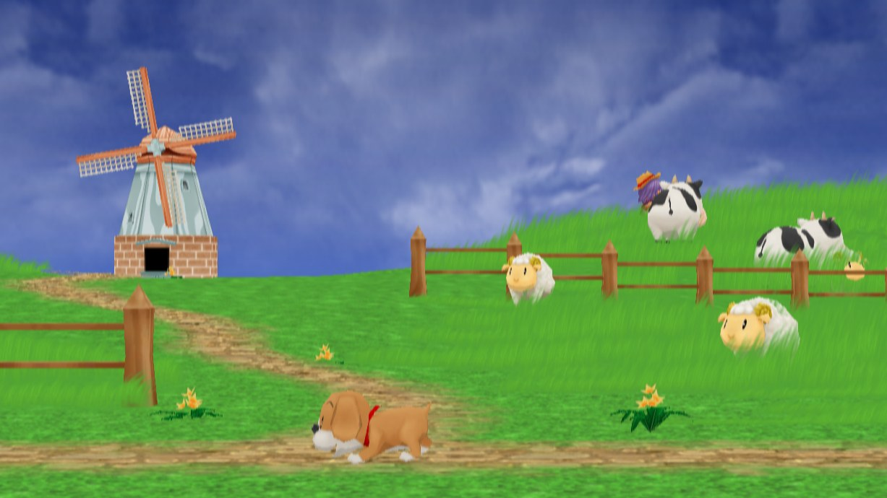
</p>

<p align="center"><b>English</b> · <a href="README.es.md">Español</a></p>

A native PC version of *Harvest Moon: Magical Melody* for the GameCube. The
game's own code is translated ahead of time into C++ and compiled into a
Windows program that runs on your processor, Intel, AMD or ARM, with no
emulator in between. It plays in widescreen, at your screen's resolution and
at 60 or 120 frames a second, with a launcher, an options menu inside the game
and mods, among them one that lets the game go on after marrying Jamie.

The game is not included: you need your own disc. The launcher makes the game
from it, on your computer, the first time you play.

> [!NOTE]
> **Version 0.1.0, the first playable version.** The game starts, plays,
> saves and loads, and it has been played on a Windows laptop with a
> Snapdragon X. It has not been played from start to finish yet, which is what
> 1.0 will mean. Expect bugs, and keep a copy of your saves.

- [What's in it](#whats-in-it)
- [Screenshots](#screenshots)
- [Playing](#playing)
- [How it works](#how-it-works)
- [What comes next](#what-comes-next)
- [For developers](#for-developers)
- [Credits](#credits)
- [License](#license)

## What's in it

### The game, running natively

- **No emulator.** Every function of the game is translated to C++ and runs
  as native code, on x64 or ARM64. What the GameCube's hardware did is done
  by a runtime written for this game (`runtime/`).
- **Graphics** with [aurora](https://github.com/encounter/aurora), which
  draws the GameCube's graphics with WebGPU: Direct3D 12 on Windows, Vulkan on
  Linux.
- **Sound** with the console's sound program (the DSP's AX) rewritten in C++
  after Dolphin's high-level emulation, and played through SDL.
- **Controllers**: the ones SDL knows (Xbox, PlayStation, Nintendo, GameCube
  adapters), mapped automatically; without one, the keyboard.
- **Saves** on a memory card that is a folder of `.gci` files, as in Dolphin,
  so a save can be brought over.
- **Loading** straight from the disc image, with no drive to wait for.

### Picture, speed and sound

| Option | What it does |
|---|---|
| Internal resolution | As the window, 480p, 720p, 1080p or 1440p. |
| Widescreen | The 3D shows more at the sides. For now the menus and the text are stretched. |
| Frames per second | 30, as the game, or 60 and 120: the game draws 30 and the rest are made in between. |
| Pull the camera back | Outdoors, from 0% (the game's camera) to 100% (much more of the farm in view). Rooms and scenes keep the game's camera. |
| Turbo | Not an option: hold Tab in the game and it goes at 300%. |
| Full screen | Also with Alt+Enter while playing. |
| Frame counter and volume | The frames per second over the game, and the volume from 0 to 100%. |

### The launcher

`HarvestMoonMM.exe` prepares the game from your disc and starts it. Its four
tabs are **Game** (prepare, play, change the disc, open the log), **Options**
(the table above), **Mods** and **Controls** (it shows the mapping and what
each button of your controller is on the GameCube's). It speaks English and
Spanish, and is used with the mouse, the keyboard or a controller. If
something fails it says why in plain words (another game, another version of
it, an image it could not read) and offers to open the log.

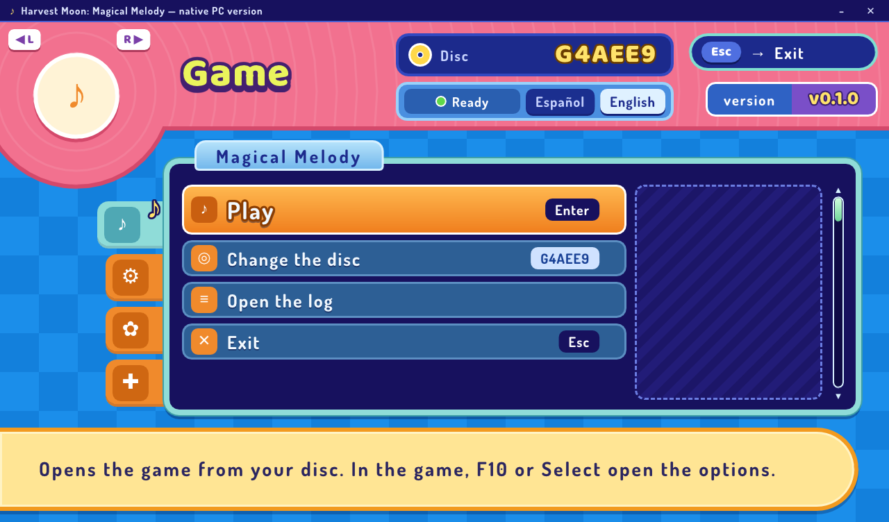

### Options inside the game

**F10**, or the controller's **Select**, opens the same options without
leaving the game. They change at once and are kept for the next time; the
controls screen is there too. While the menu is open the game does not get
the controller.

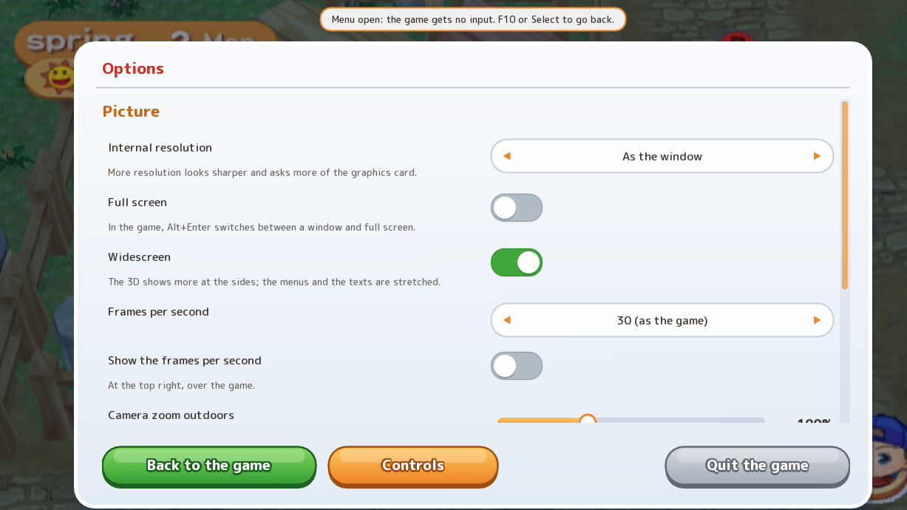

### Mods

| Mod | What it does |
|---|---|
| **Marry Jamie** (0.8.0) | In the original game, the wedding with Jamie is the ending. With this mod the wedding plays and the game goes on: Jamie lives in the house as your spouse and talks as your spouse, with new lines in the five languages of the disc, has a birthday (the 22nd of Winter), and there are the pregnancy, the birth and the special days of the marriage, as with the other partners. |
| **Faster character** (0.1.0) | The character walks and runs faster, from 25% to 300% of the original speed (150% by default), only while you control it. |
| **No slowdown when carrying** (0.1.0) | In the original game, with something in the hands the character can only walk. With this mod, with the stick fully pushed it moves at running speed. |

All are on unless the Mods tab turns them off. How to make one:
[mods/README.md](mods/README.md).

#### Marry Jamie, working in the game

<table>
  <tr>
    <td width="50%">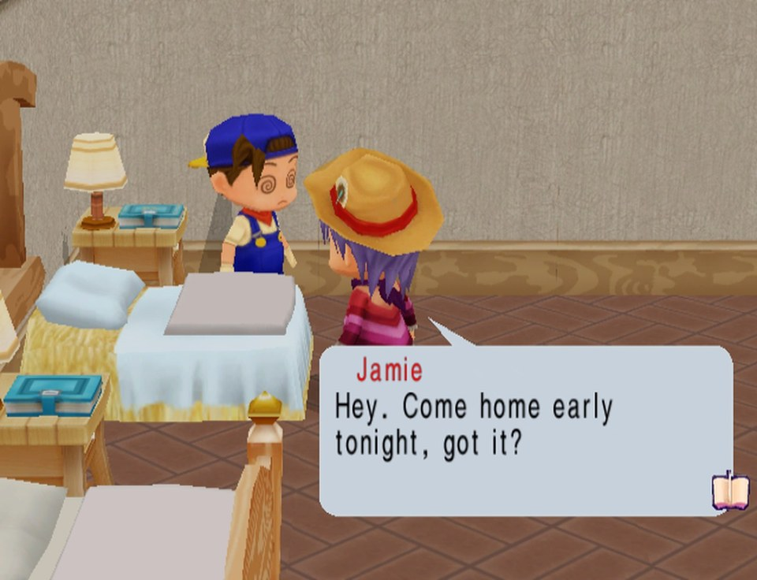</td>
    <td width="50%">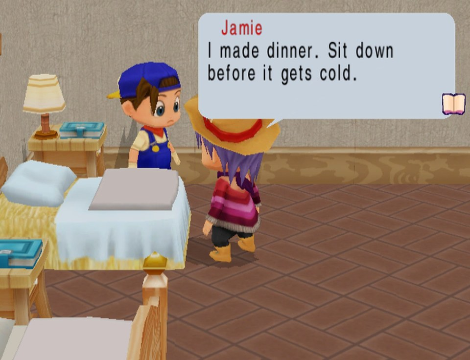</td>
  </tr>
  <tr>
    <td align="center">The wedding anniversary, in the morning…</td>
    <td align="center">…and the dinner, when you remembered</td>
  </tr>
  <tr>
    <td>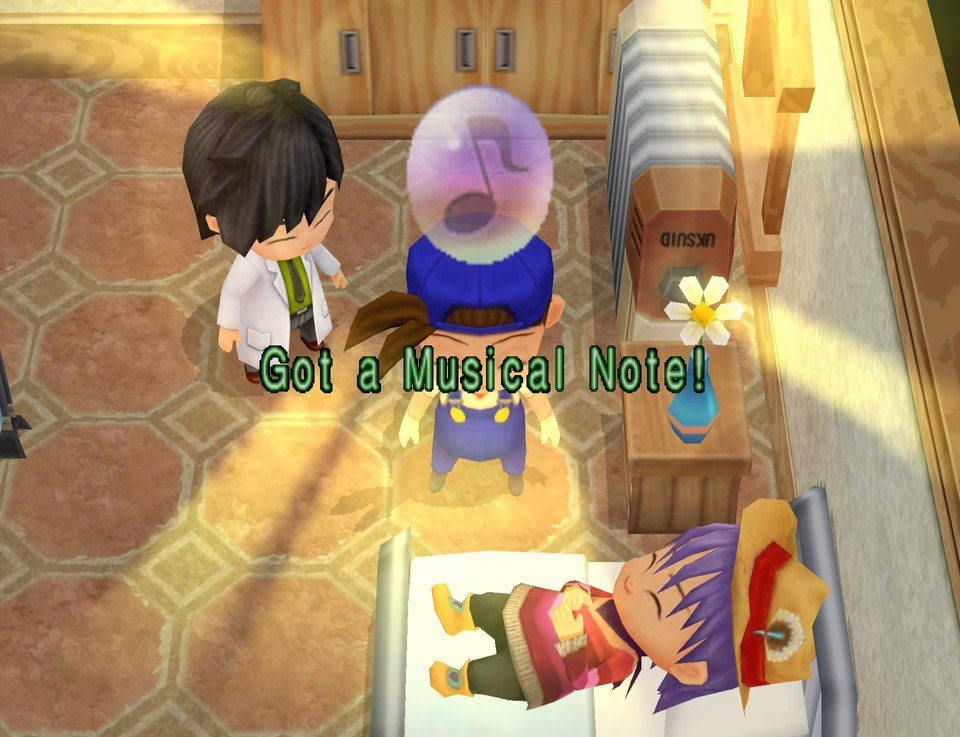</td>
    <td>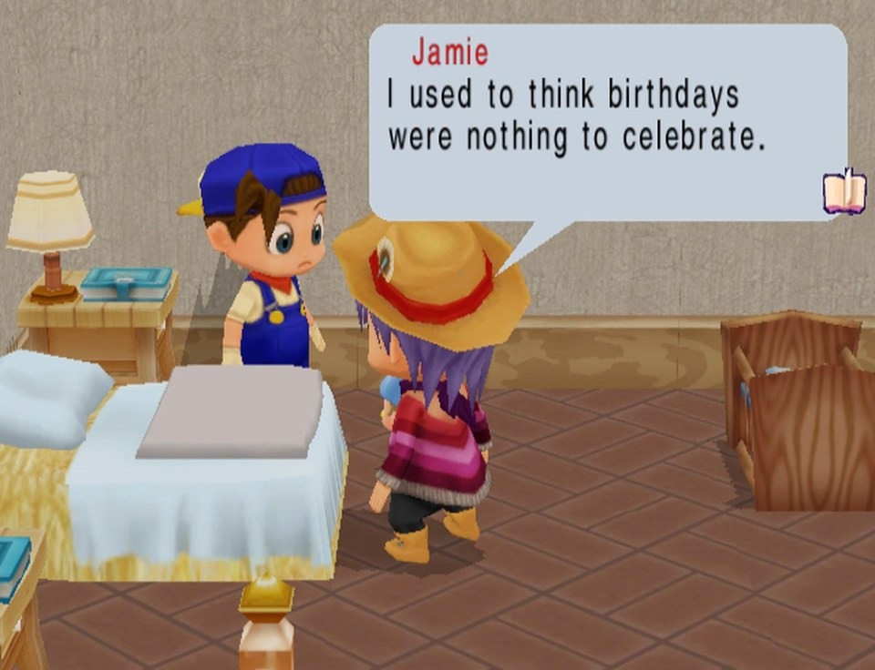</td>
  </tr>
  <tr>
    <td align="center">The pregnancy, with its Musical Note</td>
    <td align="center">The child's birthday</td>
  </tr>
  <tr>
    <td colspan="2" align="center">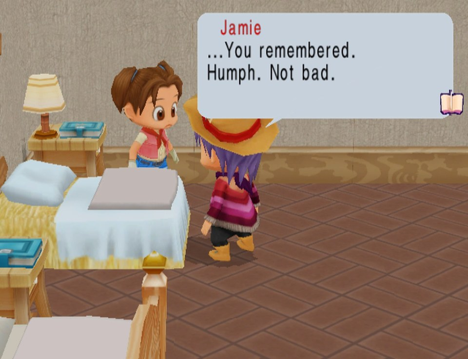</td>
  </tr>
  <tr>
    <td colspan="2" align="center">Playing as the girl, on the anniversary</td>
  </tr>
</table>

## Screenshots

<table>
  <tr>
    <td width="50%">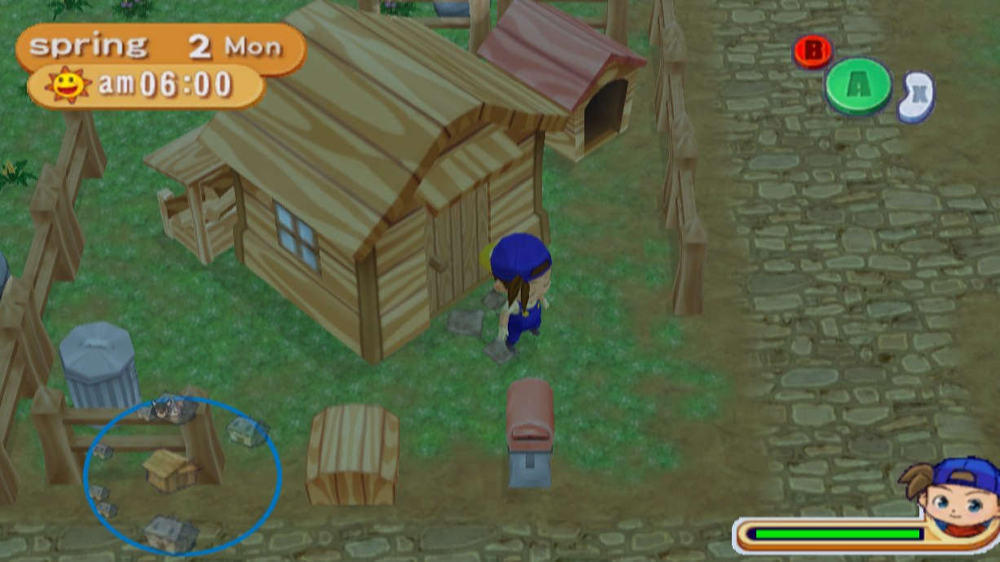</td>
    <td width="50%">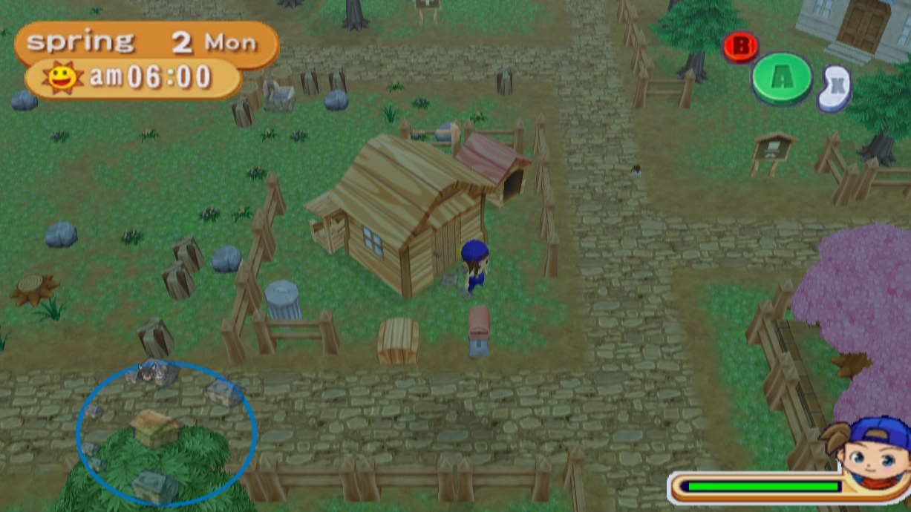</td>
  </tr>
  <tr>
    <td align="center">Widescreen, with the game's camera</td>
    <td align="center">The same moment, with the camera pulled back to 100%</td>
  </tr>
  <tr>
    <td>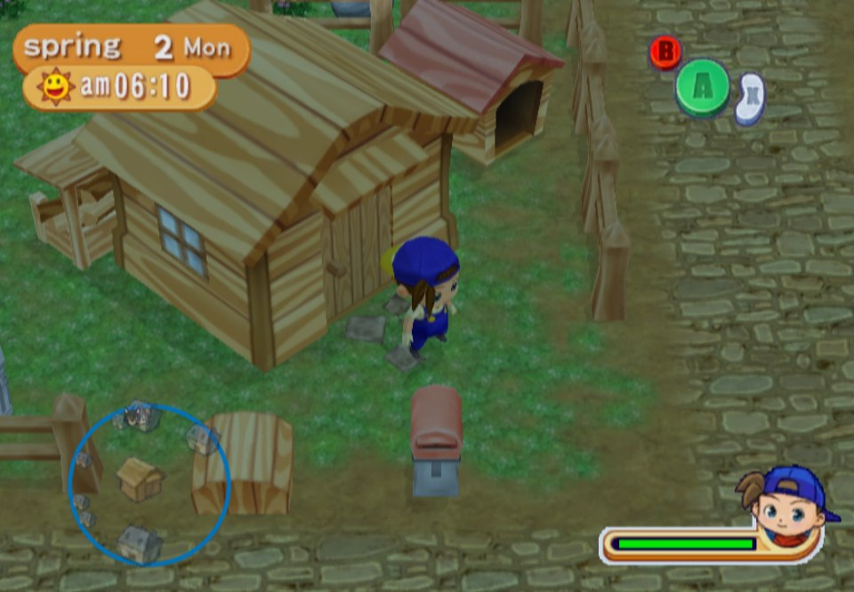</td>
    <td>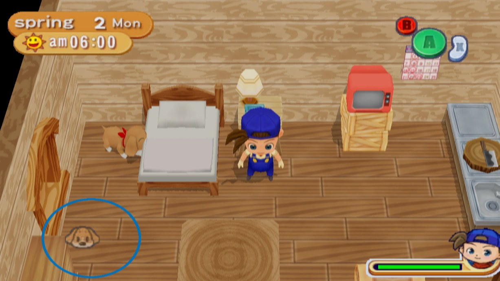</td>
  </tr>
  <tr>
    <td align="center">4:3, as on the GameCube</td>
    <td align="center">The house in the morning</td>
  </tr>
  <tr>
    <td>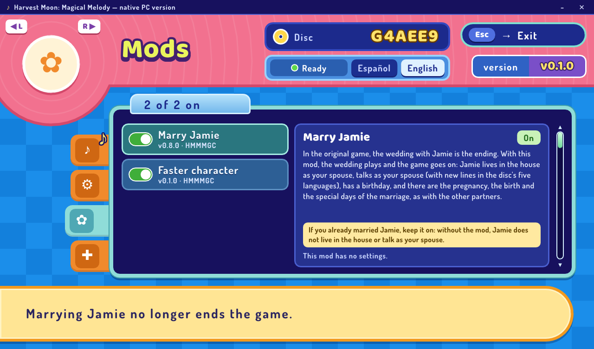</td>
    <td>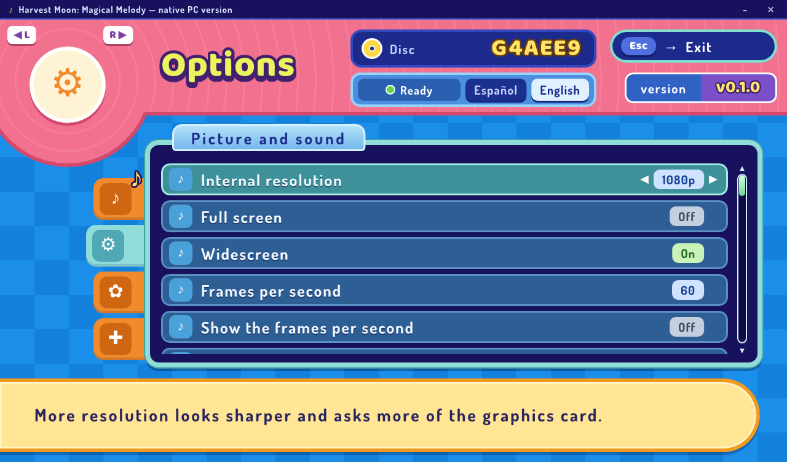</td>
  </tr>
  <tr>
    <td align="center">The launcher's mods</td>
    <td align="center">The launcher's options</td>
  </tr>
</table>

## Playing

### What you need

- Windows 10 (version 1903 or newer) or Windows 11, with an Intel or AMD
  processor (the **x64** package) or an ARM one such as the Snapdragon (the
  **arm64** package).
- A graphics card with Direct3D 12.
- Your disc of *Harvest Moon: Magical Melody* for the USA (`G4AEE9`), as an
  image: `.iso`, `.gcm` or `.rvz` (Dolphin's compressed format). The launcher
  checks that it is that game and that version.
- About 2 GB free: an `.rvz` image is converted to `.iso`, and the prepared
  game takes about 100 MB.

### Steps

1. Download the zip for your processor from
   [Releases](https://github.com/RodoLy/HMMMGC/releases).
2. Before unzipping it, right-click it → *Properties* → tick *Unblock* →
   *OK*. Otherwise Windows may stop the tools that prepare the game.
3. Unzip all of it into a folder and open `HarvestMoonMM.exe`. The program is
   not signed, so Windows may say that it does not know the publisher:
   *More info* → *Run anyway*.
4. Choose **Prepare the game** and pick your disc image (or drop it on the
   window). The first time, the game is made for your computer: it takes a
   few minutes, and then never again until the next update.
5. Press **Play**.

### Controls

The first controller you connect plays, mapped automatically. Without one,
the keyboard plays, with the same keys as Dolphin by default:

| GameCube | Keyboard |
|---|---|
| Control Stick | Arrow keys |
| C Stick | I, J, K, L |
| D-Pad | T, F, G, H |
| A, B, X, Y | X, Z, C, S |
| Z | D |
| L, R | Q, W |
| START | Enter |

Also: **F10** opens the options, holding **Tab** speeds the game up, and
**Alt+Enter** switches to full screen.

### Your saves

They are in `%LOCALAPPDATA%\HarvestMoonMM\Native\USA\Card A`, one `.gci` file
for each file on the memory card. To bring a save from Dolphin, when it keeps
the memory card as a GCI folder, or from the earlier ModernGekko version,
copy its `E9-G4AE-HARVESTMOON.gci` there. Your choices are in
`%LOCALAPPDATA%\HarvestMoonMM\settings.json`, and the logs, `prepare.log` and
`native.log`, in the `Native` folder.

If something fails, open an [issue](https://github.com/RodoLy/HMMMGC/issues)
with the log.

## How it works

```
your disc image (.iso, .gcm or .rvz)
   │  nodtool turns an .rvz into an .iso; the launcher checks the game and its version
   ▼
main.dol: the game's code, for the GameCube's PowerPC processor
   │  WiiCompiled's translator
   ▼
C++: each function of the game, as a C++ function
   │  clang (llvm-mingw), with the runtime kit, on your computer
   ▼
hmmm-native.exe: the game, as a program for your PC
```

The GameCube's processor is a PowerPC, so its code cannot run on a PC as it
is. The translator of [WiiCompiled](https://github.com/patchzyy/wiicompiled),
the recompilation of Mario Kart Wii, turns each function of the game into
C++, and that C++ is compiled together with a runtime that gives it what it
expects from the console: memory, the processor's special registers, the
operating system's threads, alarms and interrupts, the disc, the memory card,
the controllers, the graphics and the sound.

The translated C++ is the game, so it cannot be handed out. The download
brings everything else: the runtime already compiled (the *runtime kit*), the
translator, a C++ compiler (llvm-mingw) and Python. The launcher makes the
program on your computer from your disc, and nothing in the package comes
from the disc. The mods are compiled into the program, and the places where
they act are marked in the translated code.

More: [docs/NATIVE_PACKAGE.md](docs/NATIVE_PACKAGE.md) (the package and the
preparation), [runtime/README.md](runtime/README.md) and
[docs/NATIVE_RUNTIME.md](docs/NATIVE_RUNTIME.md) (the runtime),
[docs/PLAN.md](docs/PLAN.md) (the whole plan).

Before the native version, the recompiled game ran with
[DolRecomp](https://github.com/ExpansionPak/DolRecomp) on
[ModernGekko](https://github.com/ExpansionPak/ModernGekko), which keeps
Dolphin's core for the hardware. That package is still in the repository
([packaging/windows/README.md](packaging/windows/README.md)), and it was the
test bench of the Jamie mod.

## What comes next

- **1.0**: the game played from start to finish.
- The menus and the text at 4:3 in widescreen, instead of stretched.
- The game in Spanish, French, German or Italian: the American disc carries
  the translations of a European release that never came out.
- More mods: cheats, and fast-forwarding the scenes.
- Updating from the launcher, a signed program, and a package for Linux.
- Later, the two Wii versions of the game on the same runtime.

## For developers

- The native runtime on Linux: `scripts/build_native_runtime.sh`
  ([runtime/README.md](runtime/README.md)). It needs your disc extracted in
  `orig/G4AEE9`.
- The launcher and the Windows package, which GitHub Actions builds when a
  version is published: [docs/NATIVE_PACKAGE.md](docs/NATIVE_PACKAGE.md).
- How the game was analysed: [docs/DISC_ANALYSIS.md](docs/DISC_ANALYSIS.md),
  [docs/FUNCTION_MAP.md](docs/FUNCTION_MAP.md) (4,486 functions, checked
  against CodeWarrior's exception index) and
  [docs/VALIDATION.md](docs/VALIDATION.md) (the recompiled code compared with
  Dolphin's interpreter, during play and instruction by instruction).

**Target binary:** `Harvest Moon: Magical Melody (USA)`, ID `G4AEE9`,
revision 0. `sys/main.dol` SHA-1 `5977972cd798d60ecfcf5c1f26a86dcecc36446f`.

The analysis tools need Python 3.11 or newer, and Rust to install `nodtool`:

```sh
# 1. Tools
cargo install nodtool                    # reads ISO/GCM/RVZ
python3 -m pip install -r requirements-dev.txt   # capstone, pytest, ruff

# 2. Extract your disc to orig/G4AEE9 and check it is the right binary
python3 tools/extract_disc.py path/to/your/disc.rvz
python3 tools/check_disc.py

# 3. Regenerate and check the function map
python3 tools/analyze.py
HM_MM_DOL=orig/G4AEE9/sys/main.dol python3 -m pytest

# 4. Read any function
python3 tools/disasm.py main
```

On Windows:

- Install the **x64** Python from [python.org](https://www.python.org/downloads/windows/),
  even if your PC has an ARM processor: `capstone` ships no prebuilt package
  (wheel) for Windows ARM64, and x64 Python runs there through Windows 11's
  emulation. (With Visual Studio and its C++ tools for ARM64, ARM64 Python
  works too: `pip` builds `capstone` from source, as the GitHub workflow does.)
- Use `py` instead of `python3`. In PowerShell, set the tests' variable like
  this:

  ```powershell
  $env:HM_MM_DOL = "orig/G4AEE9/sys/main.dol"
  py -m pytest
  ```

- If you already use Dolphin you need neither Rust nor `nodtool`: right-click
  the game → *Properties* → *Filesystem* tab → right-click the disc →
  *Extract Entire Disc...*, and pick the `orig\G4AEE9` folder. Then
  `py tools/check_disc.py` confirms it came out right.

Read [CONTRIBUTING.md](CONTRIBUTING.md) before contributing.

## Credits

- [WiiCompiled](https://github.com/patchzyy/wiicompiled): the translator, and
  the example of a recompilation that runs without an emulator.
- [aurora](https://github.com/encounter/aurora): the GameCube's graphics,
  controllers and memory card, on [Dawn](https://dawn.googlesource.com/dawn)
  (WebGPU).
- [Dolphin](https://dolphin-emu.org/): the reference for the hardware; the
  sound program is ported from its high-level emulation.
- [DolRecomp](https://github.com/ExpansionPak/DolRecomp) and
  [ModernGekko](https://github.com/ExpansionPak/ModernGekko): the first
  playable recompilation of the game.
- [SDL](https://www.libsdl.org/), [Dear ImGui](https://github.com/ocornut/imgui),
  [nod](https://github.com/encounter/nod),
  [llvm-mingw](https://github.com/mstorsjo/llvm-mingw) and the fonts Baloo 2,
  Dosis, M PLUS Rounded 1c and DejaVu Sans. The whole list, with the
  licenses, is in
  [packaging/native/THIRD_PARTY_NOTICES.txt](packaging/native/THIRD_PARTY_NOTICES.txt).

## License

GNU General Public License, version 3 or later (GPL-3.0-or-later); the text
is in [LICENSE](LICENSE). It is the license of WiiCompiled and ModernGekko and
is compatible with those of DolRecomp and Dolphin. The patches in `patches/`
modify files derived from Dolphin that are GPL-2.0-or-later and are offered
under those same terms.

This is a fan project, not affiliated with Natsume, Marvelous or Nintendo.
*Harvest Moon: Magical Melody* was developed by Marvelous Interactive and
published by Natsume. No part of the game is in this repository or in its
downloads.
