# Harvest Moon: Magical Melody – PC recompilation

<p align="center">
  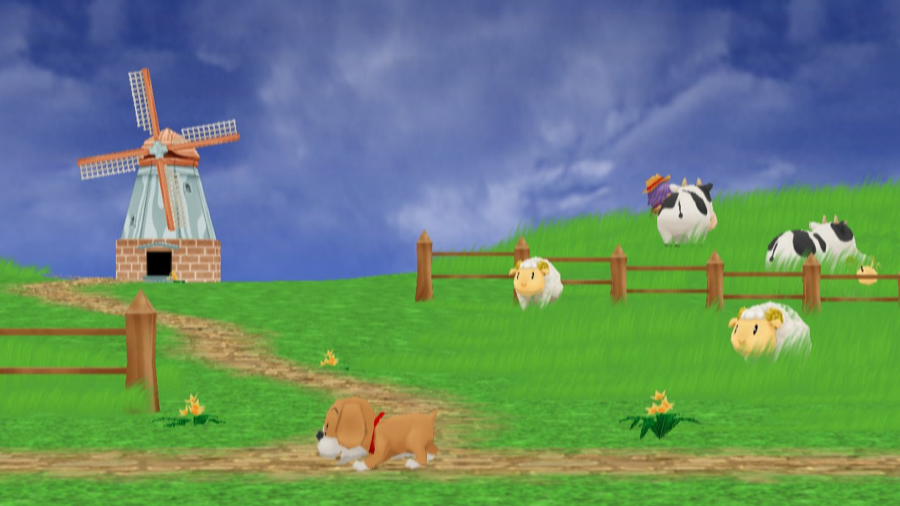
</p>

<p align="center"><b>English</b> · <a href="README.es.md">Español</a></p>

<p align="center"><a href="https://recomplauncher.com"><picture><source media="(prefers-color-scheme: dark)" srcset="https://recomplauncher.com/assets/press/launcher/badge-light.svg"></picture></a></p>

A native version of *Harvest Moon: Magical Melody* for the GameCube, for PC
and Android. The game's own code is translated ahead of time into C++ and
compiled into a Windows, Linux or Mac program, or an Android app, that runs on
your processor, Intel, AMD or ARM, with no emulator in between. It plays in
widescreen, at your screen's resolution and at 60 or 120 frames a second, with
a launcher, an options menu inside the game, cheats and mods, among them one
that lets the game go on after marrying Jamie. On a phone it plays with a
controller or with touch buttons.

The game is not included: you need your own disc. On a computer, the launcher
makes the game from it the first time you play; on Android, the app asks for
the disc the first time you open it.

> [!NOTE]
> **Version 0.4.2.** The game starts, plays, saves and loads on Windows,
> Linux, Mac and Android, and it has been played on a Windows laptop with a
> Snapdragon X. It has not been played from start to finish yet, which is what
> 1.0 will mean. Expect bugs, and keep a copy of your saves.

- [What's in it](#whats-in-it)
- [Screenshots](#screenshots)
- [Playing](#playing)
- [How it works](#how-it-works)
- [What comes next](#what-comes-next)
- [For developers](#for-developers)
- [Credits](#credits)
- [License](#license)

## What's in it

### The game, running natively

- **No emulator.** Every function of the game is translated to C++ and runs
  as native code, on x64 or ARM64. What the GameCube's hardware did is done
  by a runtime written for this game (`runtime/`).
- **Graphics** with [aurora](https://github.com/encounter/aurora), which
  draws the GameCube's graphics with WebGPU: Direct3D 12 on Windows, Vulkan on
  Linux and Android, and Metal on a Mac.
- **Sound** with the console's sound program (the DSP's AX) rewritten in C++
  after Dolphin's high-level emulation, and played through SDL.
- **Controllers**: the ones SDL knows (Xbox, PlayStation, Nintendo, GameCube
  adapters), mapped automatically; without one, the keyboard, and on Android
  the touch buttons.
- **Saves** on a memory card that is a folder of `.gci` files, as in Dolphin,
  so a save can be brought over.
- **Loading** straight from the disc image, with no drive to wait for.

### Picture, speed and sound

| Option | What it does |
|---|---|
| Internal resolution | As the window, 480p, 720p, 1080p or 1440p. |
| Widescreen | The 3D shows more at the sides. For now the menus and the text are stretched. |
| Frames per second | 30, as the game, or 60 and 120: the game draws 30 and the rest are made in between. |
| Language | One for the game and the launcher: English, Spanish, French, German or Italian, the ones the disc has. The launcher and the F10 menu are only in Spanish and English. In the game the dialogues change. The menus and the names of the items stay in English. |
| Turbo | Not an option: hold Tab in the game (or TURBO on the touch screen) and it goes at 300%. |
| Touch buttons | Only on Android: **No touch buttons with a controller** takes them away while a controller is connected (they come back if it is disconnected), and **No TURBO touch button** takes away only TURBO. |
| Full screen | Also with Alt+Enter while playing. |
| Frame counter and volume | The frames per second over the game, and the volume from 0 to 100%. |

### The launcher

`HarvestMoonMM.exe` prepares the game from your disc and starts it. Its five
tabs are **Game** (prepare, play, change the disc, choose the language, make
the Android app), **Options** (the table above), **Mods** (the quality-of-life
ones go last, in their own section), **Cheats** and **Controls** (it shows the
mapping and what each button of your controller is on the GameCube's). It
speaks English and
Spanish, and is used with the mouse, the keyboard or a controller. If
something fails it says why in plain words (another game, another version of
it, an image it could not read) and offers to open the log.

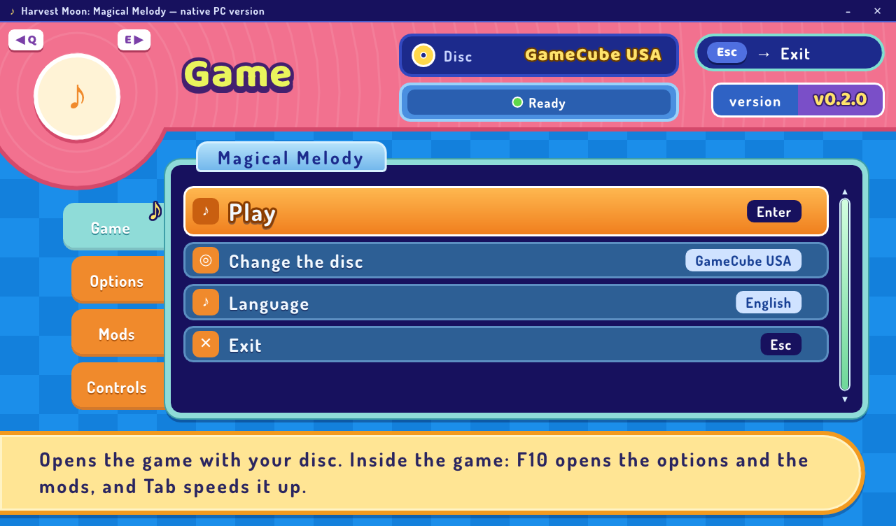

### Options inside the game

**F10**, the controller's **Select** or, on Android, the options button at
the top in the middle opens the same options without leaving the game, in a
plain bar at the top with drop-down menus: the resolution, Picture (full
screen, widescreen, frames per second and the counter; on Android, also the
two options of the touch buttons), Controller settings, Volume, Language and
Mods. The options change at once and are kept for the next time. The mods can
be turned on or off there too, with the quality-of-life ones apart: the two of
the character's speed change at once, and the rest the next time the game is
opened (the menu says which is which). While the menu is open the game does
not get the controller.

### Mods

| Mod | What it does |
|---|---|
| **Marry Jamie** (0.8.0) | In the original game, the wedding with Jamie is the ending. With this mod the wedding plays and the game goes on: after the ceremony with the Harvest Goddess, the scene of the musical notes plays once and you appear in your house, already married; the next morning brings the wedding's musical note. From then on Jamie lives in the house as your spouse and talks as your spouse, with new lines in the five languages of the disc, has a birthday (the 22nd of Winter), and there are the pregnancy, the birth and the special days of the marriage, as with the other partners. Once you marry Jamie, that save keeps using the mod even if you turn it off. |
| **Marry anyone** (0.2.1, experimental) | In the original game the boy can only marry the ten girls and the girl only the ten boys. With this mod you can court and marry any of the twenty, whichever character you chose: the blue feather works with all of them, the love scenes and the wedding come as with any partner, and at the wedding you wear your own suit or dress. For a couple of the same sex, the spouse's first words say "husband" or "wife" as they should, in the five languages, and instead of the pregnancy the Harvest Goddess calls you to her spring and offers you a baby to adopt, for your great love (if she is still stone, one of her sprites comes); you name it and place its crib at home. Once you are engaged or married to someone of your own sex, that save keeps using the mod even if you turn it off. |

#### Quality of life

Mods that do not change the story, they only make each day more comfortable.
In the launcher, the F10 menu and RecompLauncher they have their own section,
at the end.

| Mod | What it does |
|---|---|
| **Faster character** (0.1.0) | The character walks and runs faster, from 25% to 300% of the original speed (150% by default), only while you control it. |
| **No slowdown when carrying** (0.1.0) | In the original game, with something in the hands the character can only walk. With this mod, with the stick fully pushed it moves at running speed. |
| **Farther camera** (0.1.0) | In the game, up and down on the D-pad bring the camera closer and pull it back. With this mod, holding down past the game's limit keeps pulling it back, until much more of the farm is in view; up brings it back. Only outdoors: rooms and scenes keep the game's camera. |
| **Longer days** (0.1.0) | The game's clock goes more slowly, so each day gives more time to farm, fish and visit: from 100% (the original day) to 400% (a day four times as long), 150% by default. Sleeping, the events and the start of the day do not change. |
| **Gentler stamina** (0.1.0) | Everything that spends stamina (the tools, fishing, running a long way) spends only a share of it, from 10% to 100% (the original game), 50% by default. Eating and sleeping give it back as always, and being tired still makes work cost more. |
| **Faster tools** (0.1.0) | Each use of a tool counts for more towards its next level, from 100% (the original game) to 400%, 200% by default. For now one tool, which the game raises in another way, is not changed. |

All come off, like the original game; you turn them on in the Mods tab, in
the F10 menu or on the game's page in RecompLauncher. How to make one:
[mods/README.md](mods/README.md).

### Cheats

On the launcher's Cheats tab (and in RecompLauncher, in their own group) there are four
cheats, all off until you turn them on: **infinite stamina** (work spends none), **infinite money**
(it stays at 999,999 G), **stop time** (the clock does not move; sleeping still goes on to the next
day) and **maximum friendship** (with everyone; it cannot be undone in that save, and love and rival
scenes may start). They are kept in `settings.json`, under `cheats`, and the `cheats` mod does them
([mods/cheats/mod.c](mods/cheats/mod.c)).

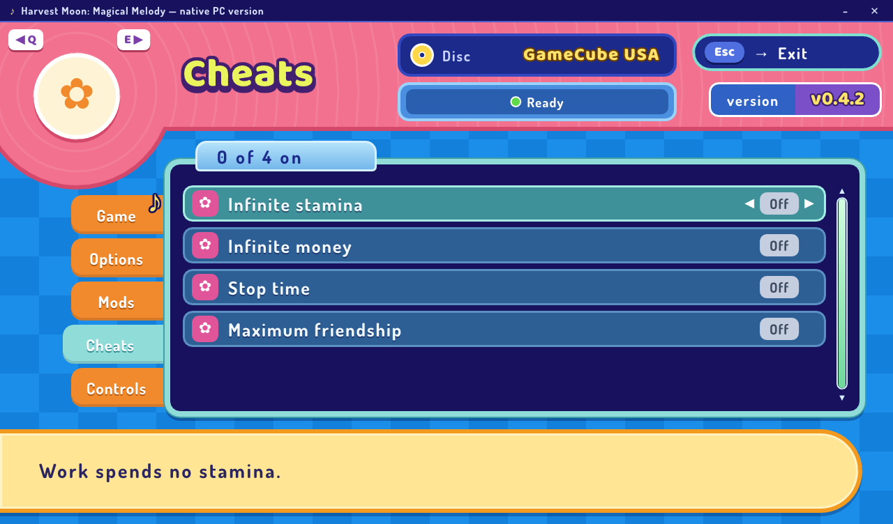

#### Marry Jamie, working in the game

<table>
  <tr>
    <td width="50%">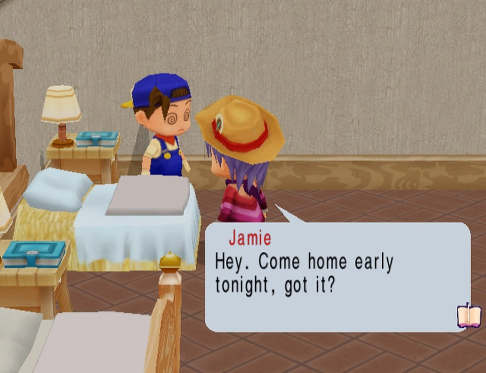</td>
    <td width="50%">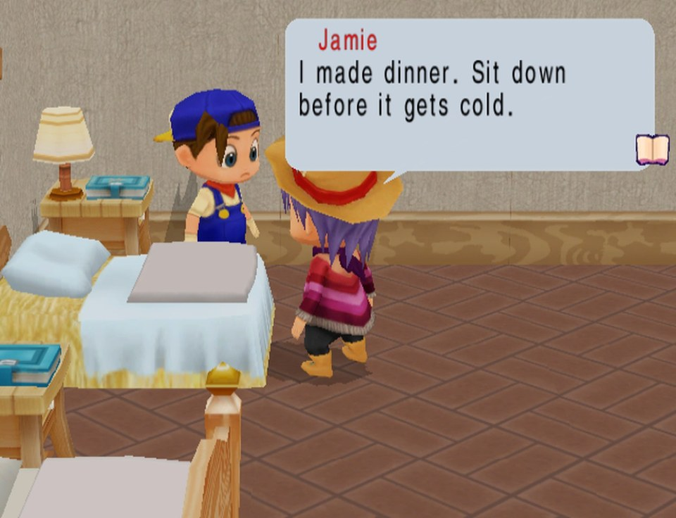</td>
  </tr>
  <tr>
    <td align="center">The wedding anniversary, in the morning…</td>
    <td align="center">…and the dinner, when you remembered</td>
  </tr>
  <tr>
    <td>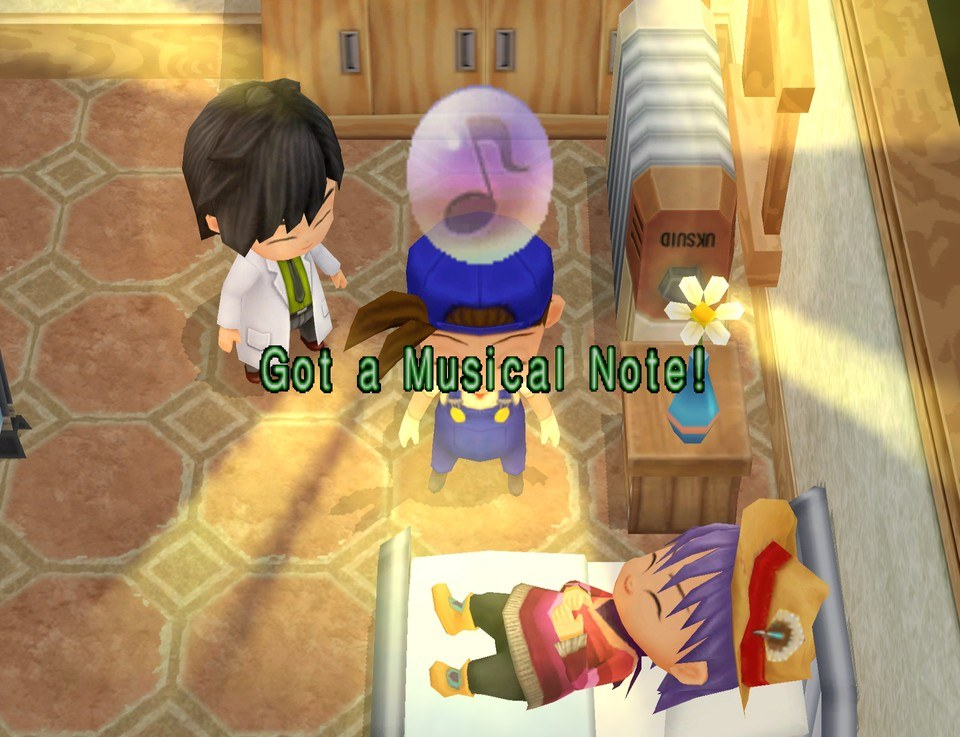</td>
    <td>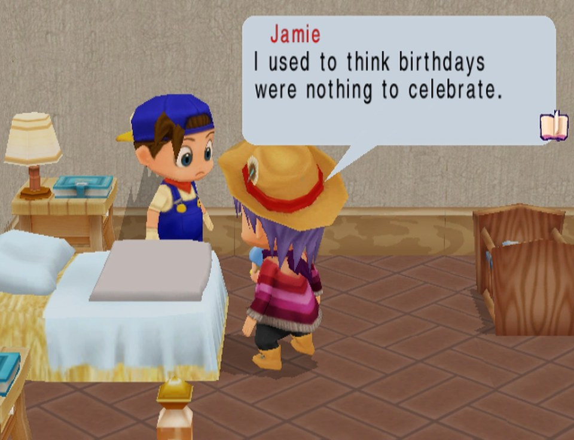</td>
  </tr>
  <tr>
    <td align="center">The pregnancy, with its Musical Note</td>
    <td align="center">The child's birthday</td>
  </tr>
  <tr>
    <td colspan="2" align="center">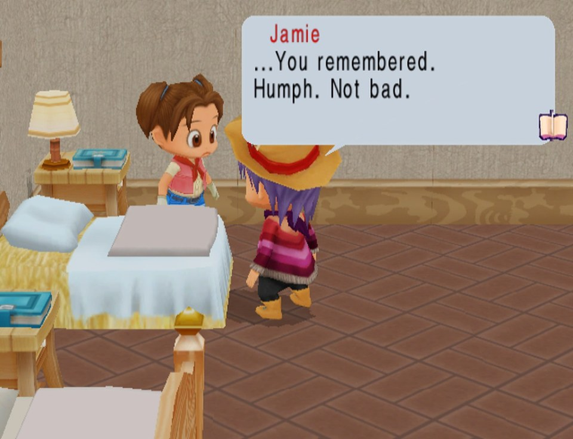</td>
  </tr>
  <tr>
    <td colspan="2" align="center">Playing as the girl, on the anniversary</td>
  </tr>
</table>

## Screenshots

<table>
  <tr>
    <td width="50%">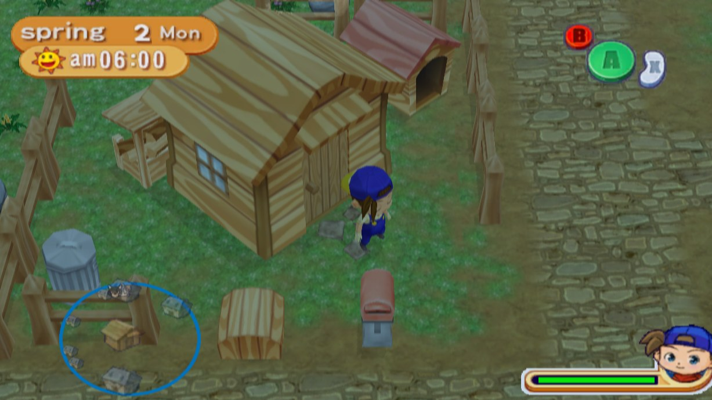</td>
    <td width="50%">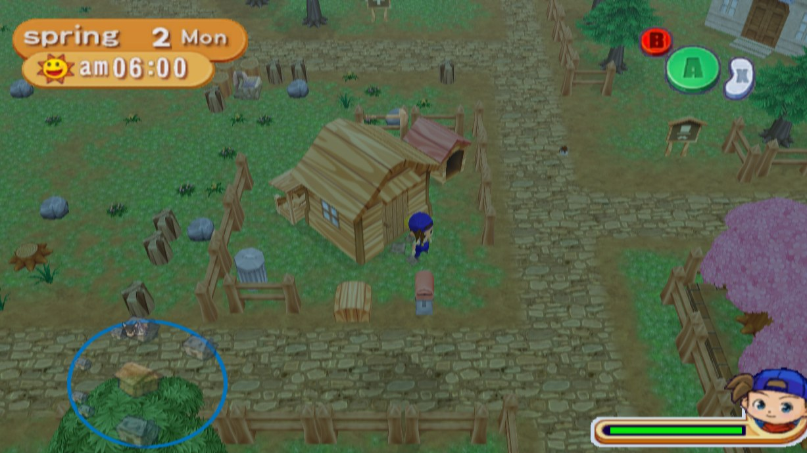</td>
  </tr>
  <tr>
    <td align="center">Widescreen, with the game's camera</td>
    <td align="center">The same moment with the Farther camera mod, pulled back all the way</td>
  </tr>
  <tr>
    <td>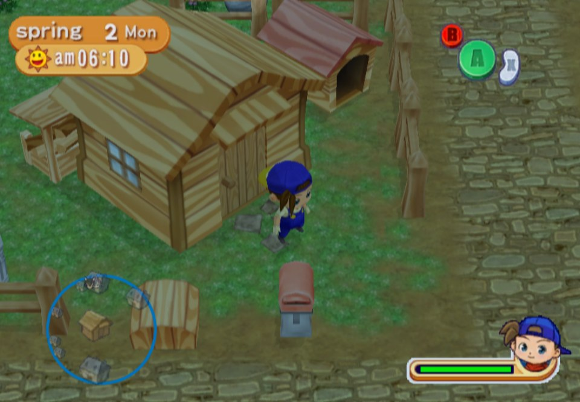</td>
    <td>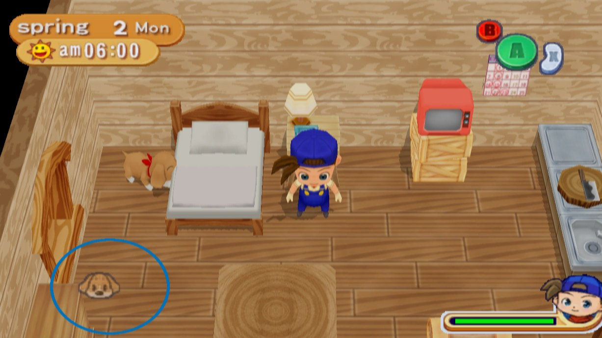</td>
  </tr>
  <tr>
    <td align="center">4:3, as on the GameCube</td>
    <td align="center">The house in the morning</td>
  </tr>
  <tr>
    <td>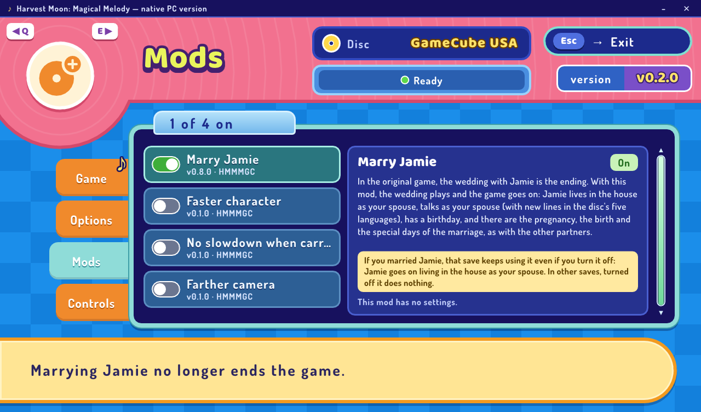</td>
    <td>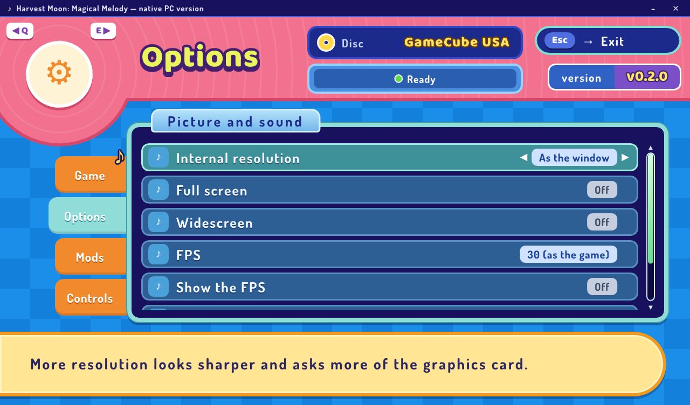</td>
  </tr>
  <tr>
    <td align="center">The launcher's mods</td>
    <td align="center">The launcher's options</td>
  </tr>
  <tr>
    <td>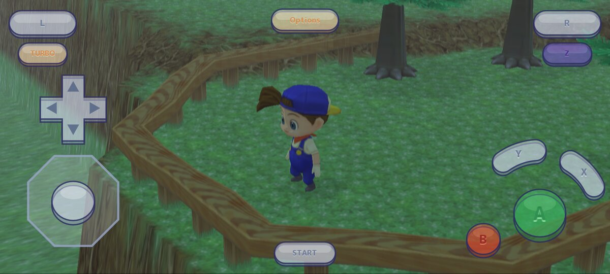</td>
    <td>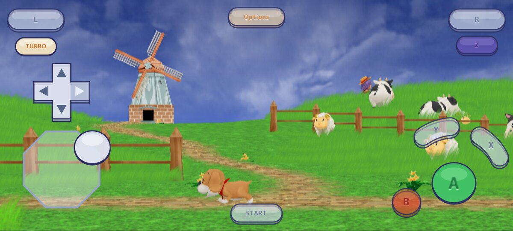</td>
  </tr>
  <tr>
    <td align="center">At a phone's size (20:9), with the touch buttons</td>
    <td align="center">A, the stick, the right arrow and TURBO pressed</td>
  </tr>
</table>

## Playing

### What you need

| | Minimum requirements |
|---|---|
| System | Windows 10 (version 1903 or newer) or Windows 11, 64-bit. Or a 64-bit Linux with glibc 2.38 or newer: Ubuntu 24.04 or newer, Debian 13, Fedora 39 or newer, Arch, SteamOS 3.6 or newer (Steam Deck). Or macOS 12 or newer, with Apple silicon or Intel. Or Android 8 or newer, on an ARM64 phone or tablet with Vulkan. |
| Processor | Intel or AMD with SSE4.2 (Intel from 2008 on, AMD from 2011 on): the **x64** package. An ARM one such as the Snapdragon: the **arm64** package. |
| Memory | 4 GB of RAM; 8 GB is better. The first time, the game is compiled on your computer, with one compiler per processor core of up to about 250 MB each. |
| Graphics | A graphics card, or the graphics of the processor, with Direct3D 12 (Windows), Vulkan (Linux and Android) or Metal (Mac). |
| Disk | About 3 GB free: the unzipped package (about 550 MB), the `.iso` that an `.rvz` image is converted to, and the prepared game (about 100 MB). On Android, about 1.5 GB: the app and the copy of the disc (1.4 GB). |
| Game | Your disc of *Harvest Moon: Magical Melody* for the USA (`G4AEE9`), as an image: `.iso`, `.gcm` or `.rvz` (Dolphin's compressed format). The launcher checks that it is that game and that version. |

Tried on a laptop with a Snapdragon X (Adreno X1-45 graphics), which keeps
60 fps in widescreen. Weaker computers have not been tried; on one close to
the minimum, 30 fps is the safest choice.

### Steps

1. Download the zip for your processor from
   [Releases](https://github.com/RodoLy/HMMMGC/releases).
2. Before unzipping it, right-click it → *Properties* → tick *Unblock* →
   *OK*. Otherwise Windows may stop the tools that prepare the game.
3. Unzip all of it into a folder and open `HarvestMoonMM.exe`. The program is
   not signed, so Windows may say that it does not know the publisher:
   *More info* → *Run anyway*.
4. Choose **Prepare the game** and pick your disc image (or drop it on the
   window). The first time, the game is made for your computer: it takes a
   few minutes, and then never again until the next update.
5. Press **Play**.

The launcher works with a controller too: the D-pad or the left stick moves,
A chooses, LB and RB change the tab, and B goes back (on the game's tab, it
exits or stops the preparation). If your disc image is in Downloads,
Documents, on the Desktop, in a `Games` folder, next to `HarvestMoonMM.exe` or
in a folder of Dolphin's game list, the launcher finds it by itself and
**Prepare the game** uses it, so you don't need the mouse to pick it.

**On Linux.** Download the `.tar.gz` for your processor, unpack it and open
`HarvestMoonMM`; from there it is the same as on Windows. It brings its own
compiler, so there is nothing to install, also on the Steam Deck (in desktop
mode; then add `HarvestMoonMM` to Steam as a non-Steam game to play it from
game mode). Everything of yours goes in `~/.local/share/HarvestMoonMM`.

**On a Mac.** Download the zip for your Mac (`arm64` for Apple silicon, `x64`
for Intel), unzip it and move `HarvestMoonMM.app` to Applications. It is not
signed by Apple, so open it the first time with right-click → *Open* (on
macOS 15, if that is not offered: try to open it, then *System Settings* →
*Privacy & Security* → *Open Anyway*). The game is compiled with Apple's
Command Line Tools; if your Mac does not have them, the launcher opens their
installer. Everything of yours goes in
`~/Library/Application Support/HarvestMoonMM`.

**On Android.** Download `HarvestMoonMM-<version>.apk` from the release and
install it on the phone (Android 8 or newer, ARM64, with Vulkan). Put your disc
image on the phone too, as `.iso` or `.gcm` (an `.rvz` can be turned into an
`.iso` with Dolphin: right-click the game → *Convert File*). The first time the
app opens it asks for the disc, checks it and copies it into the app (1.4 GB;
you can delete your copy afterwards). The APK has the game's code translated to
ARM64, but none of its graphics, music or text: those always come from your
disc. It plays with a controller or with touch buttons drawn over the game
(see [Controls](#controls)). To
update, install the new APK over the old one: your saves stay.

If you would rather make the APK yourself from your disc: download the Android
zip too, unzip it inside the folder of the Windows or Linux package, and use
**Make the Android app** on the launcher's Game tab.

**With [RecompLauncher](https://recomplauncher.com).** The package has a
`recomplauncher.json`, so RecompLauncher can install it, check your disc
image, prepare the game without opening the launcher's window, show the
options and the mods on the game's page, and start it. It runs the same
launcher (`HarvestMoonMM.exe --prepare <image>` and `--play`), so the game, the
options and the saves are the same ones either way.

### Controls

The first controller you connect plays, mapped automatically. Without one,
the keyboard plays, with the same keys as Dolphin by default. You can change
them in the launcher, on the **Controls** tab (choose the device with ◀ ▶), or
in the game: **F10**, then **Controller settings**. Both keep them in the same
file, `controls.json`, next to `settings.json`. Pick a part of the GameCube
controller and press the key (or a mouse button) or, for a controller, the
button that should play it; the changes are kept by themselves, each controller
has its own, and **Restore defaults** goes back to the automatic mapping.
(A controller's sticks always follow the controller's own.) The same list has
**Turbo (fast forward)**: Tab by default, and it can be given another key or a
controller button.

| GameCube | Keyboard |
|---|---|
| Control Stick | Arrow keys |
| C Stick | I, J, K, L |
| D-Pad | T, F, G, H |
| A, B, X, Y | X, Z, C, S |
| Z | D |
| L, R | Q, W |
| START | Enter |

Also: **F10** opens the options, holding **Tab** speeds the game up, and
**Alt+Enter** switches to full screen.

**Touch buttons.** On Android there is a GameCube controller over the game,
drawn like the game's own buttons and in its colors (A green, B red, Z
purple), see-through so that the game shows under it: the stick and the D-Pad
on the left; A, B, X and Y on the right; L, R and Z at the top; START at the
bottom; at the top in the middle, the options button (as F10), and under L,
**TURBO**, which speeds the game up while you hold it. Several can be pressed
at once. They go away when you use a controller or the keyboard, and come back
when the screen is touched or the controller is disconnected. With the options
in the table above they stay away while a controller is connected, or only
TURBO is taken away.

### Your saves

Everything of yours is in the `HarvestMoonMM` folder:

| System | Folder |
|---|---|
| Windows | `%LOCALAPPDATA%\HarvestMoonMM` |
| Linux | `~/.local/share/HarvestMoonMM` |
| Mac | `~/Library/Application Support/HarvestMoonMM` |
| Android | Inside the app (it stays when you update; it is deleted if you uninstall) |

The saves are in `Native/USA/Card A`, one `.gci` file for each file on the
memory card. To bring a save from Dolphin, when it keeps the memory card as a
GCI folder, or from the earlier ModernGekko version, copy its
`E9-G4AE-HARVESTMOON.gci` there. Your choices are in `settings.json` and your
controls in `controls.json`, and the logs, `prepare.log` and `native.log`, in
the `Native` folder.

If something fails, open an [issue](https://github.com/RodoLy/HMMMGC/issues)
with the log.

## How it works

```
your disc image (.iso, .gcm or .rvz)
   │  nodtool turns an .rvz into an .iso; the launcher checks the game and its version
   ▼
main.dol: the game's code, for the GameCube's PowerPC processor
   │  WiiCompiled's translator
   ▼
C++: each function of the game, as a C++ function
   │  clang, with the runtime kit, on your computer
   ▼
hmmm-native: the game, as a program for your system
```

The GameCube's processor is a PowerPC, so its code cannot run on a PC as it
is. The translator of [WiiCompiled](https://github.com/patchzyy/wiicompiled),
the recompilation of Mario Kart Wii, turns each function of the game into
C++, and that C++ is compiled together with a runtime that gives it what it
expects from the console: memory, the processor's special registers, the
operating system's threads, alarms and interrupts, the disc, the memory card,
the controllers, the graphics and the sound.

The computer packages do not bring the translated code: they bring
everything else, the runtime already compiled (the *runtime kit*), the
translator, a C++ compiler (llvm-mingw on Windows, its clang on Linux; on a
Mac, Apple's clang) and Python. The launcher makes the program on your
computer from your disc, and nothing in the package comes from the disc. The
mods are compiled into the program, and the places where they act are marked
in the translated code.

A phone cannot compile the game, so the Android APK already has the code
translated and compiled for ARM64, as other recompilations' Android versions
do. The graphics, the music and the text are not in it: the app always reads
them from your disc.

More: [docs/NATIVE_PACKAGE.md](docs/NATIVE_PACKAGE.md) (the package and the
preparation), [runtime/README.md](runtime/README.md) and
[docs/NATIVE_RUNTIME.md](docs/NATIVE_RUNTIME.md) (the runtime),
[docs/PLAN.md](docs/PLAN.md) (the whole plan).

Before the native version, the recompiled game ran with
[DolRecomp](https://github.com/ExpansionPak/DolRecomp) on
[ModernGekko](https://github.com/ExpansionPak/ModernGekko), which keeps
Dolphin's core for the hardware. That package is still in the repository
([packaging/windows/README.md](packaging/windows/README.md)), and it was the
test bench of the Jamie mod.

## What comes next

- **1.0**: the game played from start to finish.
- The menus and the text at 4:3 in widescreen, instead of stretched.
- The game in Spanish, French, German or Italian: the American disc carries
  the translations of a European release that never came out.
- More mods: fast-forwarding the scenes.
- Updating from the launcher.
- Later, the two Wii versions of the game on the same runtime.

## For developers

- The native runtime on Linux: `scripts/build_native_runtime.sh`
  ([runtime/README.md](runtime/README.md)). It needs your disc extracted in
  `orig/G4AEE9`.
- The launcher and the Windows, Linux, macOS and Android packages, which
  GitHub Actions builds when a version is published, and the ready APK of each
  version: [docs/NATIVE_PACKAGE.md](docs/NATIVE_PACKAGE.md).
- The Android app: [android/](android/).
- How the game was analysed: [docs/DISC_ANALYSIS.md](docs/DISC_ANALYSIS.md),
  [docs/FUNCTION_MAP.md](docs/FUNCTION_MAP.md) (4,486 functions, checked
  against CodeWarrior's exception index) and
  [docs/VALIDATION.md](docs/VALIDATION.md) (the recompiled code compared with
  Dolphin's interpreter, during play and instruction by instruction).

**Target binary:** `Harvest Moon: Magical Melody (USA)`, ID `G4AEE9`,
revision 0. `sys/main.dol` SHA-1 `5977972cd798d60ecfcf5c1f26a86dcecc36446f`.

The analysis tools need Python 3.11 or newer, and Rust to install `nodtool`:

```sh
# 1. Tools
cargo install nodtool                    # reads ISO/GCM/RVZ
python3 -m pip install -r requirements-dev.txt   # capstone, pytest, ruff

# 2. Extract your disc to orig/G4AEE9 and check it is the right binary
python3 tools/extract_disc.py path/to/your/disc.rvz
python3 tools/check_disc.py

# 3. Regenerate and check the function map
python3 tools/analyze.py
HM_MM_DOL=orig/G4AEE9/sys/main.dol python3 -m pytest

# 4. Read any function
python3 tools/disasm.py main
```

On Windows:

- Install the **x64** Python from [python.org](https://www.python.org/downloads/windows/),
  even if your PC has an ARM processor: `capstone` ships no prebuilt package
  (wheel) for Windows ARM64, and x64 Python runs there through Windows 11's
  emulation. (With Visual Studio and its C++ tools for ARM64, ARM64 Python
  works too: `pip` builds `capstone` from source, as the GitHub workflow does.)
- Use `py` instead of `python3`. In PowerShell, set the tests' variable like
  this:

  ```powershell
  $env:HM_MM_DOL = "orig/G4AEE9/sys/main.dol"
  py -m pytest
  ```

- If you already use Dolphin you need neither Rust nor `nodtool`: right-click
  the game → *Properties* → *Filesystem* tab → right-click the disc →
  *Extract Entire Disc...*, and pick the `orig\G4AEE9` folder. Then
  `py tools/check_disc.py` confirms it came out right.

Read [CONTRIBUTING.md](CONTRIBUTING.md) before contributing.

## Credits

- [WiiCompiled](https://github.com/patchzyy/wiicompiled): the translator, and
  the example of a recompilation that runs without an emulator.
- [aurora](https://github.com/encounter/aurora): the GameCube's graphics,
  controllers and memory card, on [Dawn](https://dawn.googlesource.com/dawn)
  (WebGPU).
- [Dolphin](https://dolphin-emu.org/): the reference for the hardware; the
  sound program is ported from its high-level emulation.
- [DolRecomp](https://github.com/ExpansionPak/DolRecomp) and
  [ModernGekko](https://github.com/ExpansionPak/ModernGekko): the first
  playable recompilation of the game.
- [SDL](https://www.libsdl.org/), [Dear ImGui](https://github.com/ocornut/imgui),
  [nod](https://github.com/encounter/nod),
  [llvm-mingw](https://github.com/mstorsjo/llvm-mingw) and the fonts Baloo 2,
  Dosis, M PLUS Rounded 1c and DejaVu Sans. The whole list, with the
  licenses, is in
  [packaging/native/THIRD_PARTY_NOTICES.txt](packaging/native/THIRD_PARTY_NOTICES.txt).

## License

GNU General Public License, version 3 or later (GPL-3.0-or-later); the text
is in [LICENSE](LICENSE). It is the license of WiiCompiled and ModernGekko and
is compatible with those of DolRecomp and Dolphin. The patches in `patches/`
modify files derived from Dolphin that are GPL-2.0-or-later and are offered
under those same terms.

This is a fan project, not affiliated with Natsume, Marvelous or Nintendo.
*Harvest Moon: Magical Melody* was developed by Marvelous Interactive and
published by Natsume. No part of the game is in this repository or in the
computer packages. The ready Android APK of each release carries the game's
code translated to ARM64, as other recompilations' Android versions do, but
none of the disc's files (graphics, music, text), which always come from the
player's own disc.
